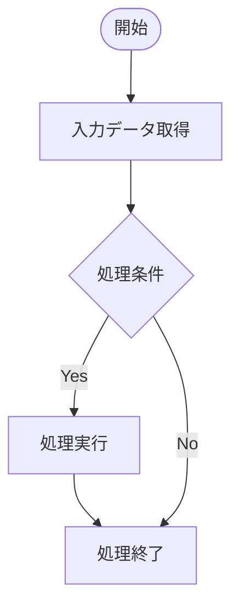

# README

# 要件書

## 業務要件

## 機能要件

## 業務フロー 

# 概要書

## 処理概要

### 1. 機能概要

<!-- 対象機能の目的と、コードから確認できる処理内容を記載する。 -->

- **機能名：** {{機能名}}
- **処理方式：** {{処理方式}}
- **処理概要：** {{処理の目的および主要な処理内容}}

### 2. 処理詳細

<!-- 実際のソースコードの処理順序に沿って記載する。 -->

1. **{{処理ステップ1}}**
   - {{処理内容}}
2. **{{処理ステップ2}}**
   - {{処理内容}}
3. **{{処理ステップ3}}**
   - {{処理内容}}

### 3. 処理条件

| No. | 判定対象 | 判定条件 | 条件成立時の処理 | 条件不成立時の処理 |
|---|---|---|---|---|
| 1 | {{判定対象}} | {{判定条件}} | {{成立時の処理}} | {{不成立時の処理}} |

### 4. 処理概要図

<!-- 実際の制御フローに基づいてMermaid図を記載する。 -->

## 前提/制約条件

### **前提条件：**

- {{処理に必要な設定情報}}
- {{処理に必要な入力データ}}
- {{実行に必要なプログラムまたは拡張設定}}
- {{その他、ソースコードまたは関連定義から確認できる前提条件}}

### **制約条件：**

- {{処理対象となるデータの条件}}
- {{処理対象外となるデータの条件}}
- {{処理範囲および適用条件}}
- {{データ不足、設定未取得等の場合の動作}}
- {{その他、コード上の制約}}

## 依存関係

<!-- 実際の呼出関係、参照関係およびデータ依存関係を記載する。 -->

| **オブジェクト名** | **種類** | **用途** |
|---|---|---|
| {{オブジェクト名}} | {{種類}} | {{用途}} |

### 使用公開API

| **API名** | **種類** | **用途** |
|---|---|---|
| {{API名}} | {{種類}} | {{用途}} |

<!-- 公開APIを使用していない場合は「該当なし」と記載する。
     内部クラス、Include、独自Function Module等は必要に応じて上記の依存関係に記載する。 -->

## 補足情報

### **メッセージ**

<!-- MESSAGE文、例外処理、メッセージ定義等から確認できる内容を記載する。 -->

| **エラーケース** | **メッセージ** | **引数** | **補足** | **クラス** |
|---|---|---|---|---|
| {{エラーケース}} | {{メッセージ番号／メッセージ本文}} | {{メッセージ引数}} | {{発生条件／補足}} | {{メッセージクラス／例外クラス}} |

<!-- メッセージが確認できない場合は「ソースコード上、該当するメッセージ出力は確認できない」と記載する。
     正常な条件不成立をエラーとして扱わない。 -->

### データモデル・項目情報

<!-- コードで参照・更新される主要なデータソースや項目を記載する。 -->

| **オブジェクト名** | **項目名** | **用途** | **処理内容** |
|---|---|---|---|
| {{テーブル／CDS／構造名}} | {{項目名}} | {{用途}} | {{参照／更新／判定等}} |

### 例外処理

<!-- ソースコードから確認できる例外処理、境界条件および特殊な分岐を記載する。 -->

- **データ取得結果が0件の場合：** {{実際の処理}}
- **設定情報が取得できない場合：** {{実際の処理}}
- **対象条件を満たさない場合：** {{実際の処理}}
- **例外発生時：** {{実際の処理}}
- **その他：** {{特記事項}}

