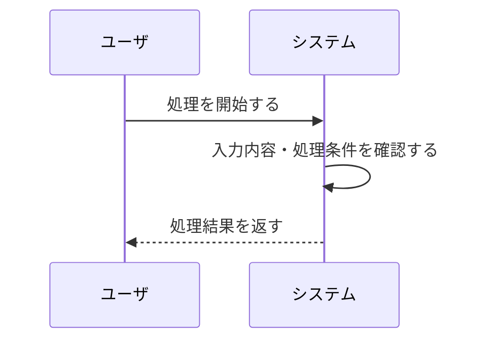
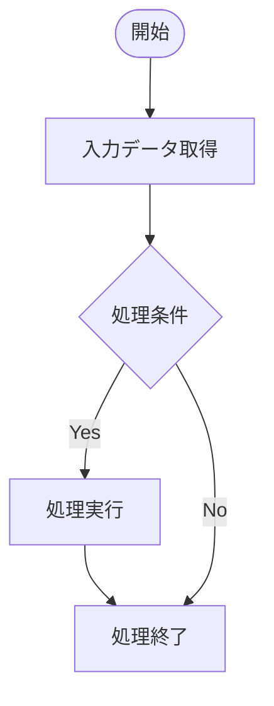

# README

<!-- 記載なし -->

# 要件書

<!-- 記載なし -->

## 業務要件

<!-- 対象業務の目的、背景、解決したい課題および業務上の期待結果を記載する。 -->

## 機能要件

<!-- システムに求める機能、入力・出力、処理条件および機能上の制約を記載する。 -->

## 業務フロー

<!-- ユーザとシステムのやり取りを時系列で記載する。登場する対象は「ユーザ」「システム」を基本とし、業務の開始から終了までの主要な操作と応答を簡潔に表現する。 -->

# 概要書

<!-- 記載なし -->

## 処理概要

<!-- 対象機能がどのような条件で起動し、どのような処理を行い、何を実現するかを全体的に説明する。 -->

### 1. 機能概要

<!-- 対象機能の目的と、コードから確認できる処理内容を記載する。 -->

- **機能名：** {{機能名}}
- **処理方式：** {{処理方式}}
- **処理概要：** {{処理の目的および主要な処理内容}}

### 2. 処理詳細

<!-- 実際のソースコードの処理順序に沿って記載する。 -->

1. **{{処理ステップ1}}**
   - {{処理内容}}
2. **{{処理ステップ2}}**
   - {{処理内容}}
3. **{{処理ステップ3}}**
   - {{処理内容}}

### 3. 処理条件

<!-- 処理の実行可否や分岐に使用する判定対象、条件および条件成立・不成立時の動作を記載する。 -->

| No. | 判定対象 | 判定条件 | 条件成立時の処理 | 条件不成立時の処理 |
|---|---|---|---|---|
| 1 | {{判定対象}} | {{判定条件}} | {{成立時の処理}} | {{不成立時の処理}} |

### 4. 処理概要図

<!-- 実際の制御フローに基づいてMermaid図を記載する。ソースコードに存在しない処理や分岐は追加しない。 -->

## 前提/制約条件

<!-- 処理が成立するために必要な設定・データ・実行条件と、処理対象や動作に関する制限を記載する。根拠を確認できない事項は確定事項として記載しない。 -->

### **前提条件：**

<!-- 処理開始前に必要な設定、マスタ・トランザクションデータ、実行環境、拡張設定などを記載する。 -->

- {{処理に必要な設定情報}}
- {{処理に必要な入力データ}}
- {{実行に必要なプログラムまたは拡張設定}}
- {{その他、ソースコードまたは関連定義から確認できる前提条件}}

### **制約条件：**

<!-- 処理対象・対象外の条件、適用範囲、データ件数や設定状態による制限、および制約に該当した場合の動作を記載する。 -->

- {{処理対象となるデータの条件}}
- {{処理対象外となるデータの条件}}
- {{処理範囲および適用条件}}
- {{データ不足、設定未取得等の場合の動作}}
- {{その他、コード上の制約}}

## 依存関係

<!-- 実際の呼出関係、参照関係およびデータ依存関係を記載する。ソースコードや定義から確認できた依存先を記載し、推測だけで追加しない。 -->

| **オブジェクト名** | **種類** | **用途** |
|---|---|---|
| {{オブジェクト名}} | {{種類}} | {{用途}} |

### 使用公開API

<!-- 対象機能が利用する公開API（標準API、公開クラス・インターフェース、公開CDSなど）を記載する。 -->

| **API名** | **種類** | **用途** |
|---|---|---|
| {{API名}} | {{種類}} | {{用途}} |

<!-- 公開APIを使用していない場合は「該当なし」と記載する。
     内部クラス、Include、独自Function Module等は必要に応じて上記の依存関係に記載する。 -->

## 補足情報

<!-- 処理概要だけでは伝わりにくいメッセージ、データ項目、例外処理など、保守・調査時に必要な補足情報を記載する。 -->

### **メッセージ**

<!-- MESSAGE文、例外処理、メッセージ定義等から確認できるメッセージ内容と発生条件を記載する。 -->

| **エラーケース** | **メッセージ** | **引数** | **補足** | **クラス** |
|---|---|---|---|---|
| {{エラーケース}} | {{メッセージ番号／メッセージ本文}} | {{メッセージ引数}} | {{発生条件／補足}} | {{メッセージクラス／例外クラス}} |

<!-- メッセージが確認できない場合は「ソースコード上、該当するメッセージ出力は確認できない」と記載する。
     正常な条件不成立をエラーとして扱わない。 -->

### データモデル・項目情報

<!-- コードで参照・更新される主要なデータソース、構造および項目について、用途と処理内容を記載する。 -->

| **オブジェクト名** | **項目名** | **用途** | **処理内容** |
|---|---|---|---|
| {{テーブル／CDS／構造名}} | {{項目名}} | {{用途}} | {{参照／更新／判定等}} |

### 例外処理

<!-- ソースコードから確認できる例外処理、境界条件および特殊な分岐と、それぞれの場合の動作を記載する。 -->

- **データ取得結果が0件の場合：** {{実際の処理}}
- **設定情報が取得できない場合：** {{実際の処理}}
- **対象条件を満たさない場合：** {{実際の処理}}
- **例外発生時：** {{実際の処理}}
- **その他：** {{特記事項}}

# テスト仕様書

## テスト仕様書
| **No** | **No** | **テストケース** | **テストケース** |　**確認内容・期待結果** |
|---|---|---|---|---|
| {{No} | {{No}} | {{テストケース}} |　{{テストケース}} |　{{確認内容・期待結果}}　|
