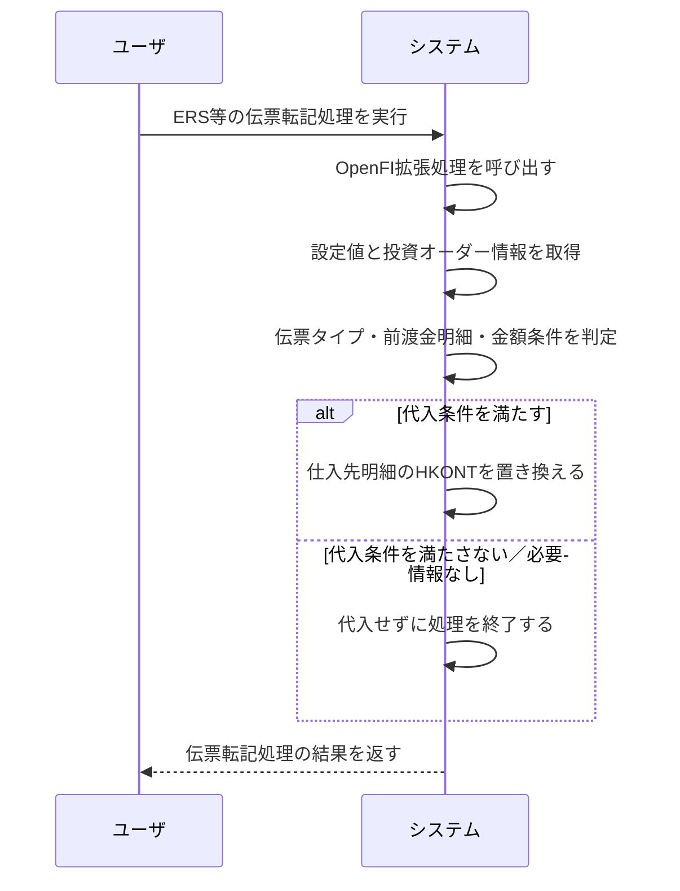
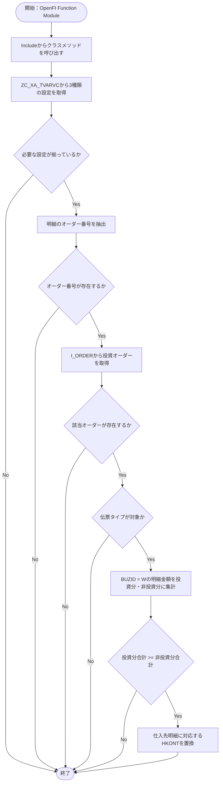

# README

<!-- 本書は、既存の設計資料およびGitHubに格納されたソースコードを基に作成した逆向き分析資料です。ソースコードで確認できる実装事実と、設計資料に基づく情報を区別して記載します。 -->

# 要件書

<!-- 統制勘定代入機能について、設計資料に記載された業務目的・機能要件を整理します。 -->

## 業務要件

<!-- 対象業務の目的と、業務上期待される結果を記載します。 -->

ERS等による伝票転記処理において、所定の条件を満たす伝票の仕入先明細に対し、設備買掛金用の統制勘定を代入する。

## 機能要件

<!-- 機能の対象条件、判定方法および更新内容を記載します。 -->

- 対象伝票タイプは、設定値 `Z_FI_PROCESS_00001120_BLART` により判定する。
- 前渡金明細（BSEG-BUZID = `W`）を対象に、投資オーダーに該当する明細金額と、それ以外の明細金額を国内通貨額（BSEG-DMBTR）で集計する。
- 投資オーダー該当明細の合計額が、それ以外の明細の合計額以上の場合、同一伝票の仕入先明細（BSEG-KOART = `K`）に対応する代入用明細のHKONTを設定値で置き換える。
- 設定値や必要な投資オーダー情報を取得できない場合は、クラス実装上、代入処理を行わずに戻る。
- 金額集計で算術オーバーフローが発生した場合は例外として上位処理へ通知する。

## 業務フロー

<!-- ユーザとシステムのやり取りを時系列で記載します。登場対象は「ユーザ」「システム」とし、システム内部の処理はシステム内の処理として表現します。 -->

# 概要書

<!-- ソースコードの構成、実際の処理順序、前提条件および依存関係を記載します。 -->

## 処理概要

<!-- 対象機能の起動経路と主要な処理を全体的に説明します。 -->

### 1. 機能概要

<!-- 対象機能の目的と、コードから確認できる処理内容を記載します。 -->

- **機能名：** 設備買掛金統制勘定代入
- **処理方式：** OpenFI Function ModuleからIncludeを介してABAPクラスの静的メソッドを呼び出す拡張処理
- **処理概要：** 設定値と投資オーダー情報を取得し、伝票タイプおよび前渡金明細の金額条件を判定する。条件を満たす場合、仕入先明細に対応する代入用明細のHKONTを設定された設備買掛金科目に置き換える。

### 2. 処理詳細

<!-- 実際のソースコードの処理順序に沿って記載します。 -->

1. **OpenFI Function Moduleから処理を呼び出す**
   - `Z_FI_PROCESS_00001120` はInclude `ZFI0001_001_01` を読み込む。
   - Includeからクラス `ZCLFI0001_001_01` の静的メソッド `Z_FI_PROCESS_00001120` を呼び出す。
2. **設定値を取得する**
   - CDS `ZC_XA_TVARVC` から次の3種類の設定名を検索する。
     - `Z_FI_PROCESS_00001120_BLART`：対象伝票タイプの範囲
     - `Z_FI_PROCESS_00001120_AUART`：投資オーダータイプの範囲
     - `Z_FI_PROCESS_00001120_HKONT`：代入する統制勘定
   - 設定レコードが0件、または必要な設定値が揃わない場合は、クラスメソッドを終了する。
3. **投資オーダーを特定する**
   - 伝票明細のAUFNRから重複を除いたオーダー番号を作成し、空のオーダー番号を除外する。
   - CDS `I_ORDER` を参照し、設定されたオーダータイプに一致するオーダー番号を取得する。
   - 対象オーダーが取得できない場合は、クラスメソッドを終了する。
4. **伝票タイプを判定する**
   - 伝票ヘッダごとに、BLARTが設定された対象伝票タイプ範囲に含まれるかを確認する。
   - 対象外の場合は、その伝票の代入判定をスキップする。
5. **前渡金明細の金額を集計する**
   - 同一会社コード・伝票番号・会計年度で、BUZID = `W` の明細を抽出する。
   - オーダー番号が投資オーダー一覧に存在する明細のDMBTRを投資分、それ以外の明細のDMBTRを非投資分として集計する。
6. **代入条件を判定する**
   - 投資分合計が非投資分合計より小さい場合は、代入しない。
   - 投資分合計が非投資分合計以上の場合は、同一伝票の仕入先明細（KOART = `K`）を検索する。
7. **統制勘定を置き換える**
   - 仕入先明細に対応する行インデックスを使用して、代入用明細テーブル `BSEG_SUBST` のHKONTに設定値を代入する。
   - 最後に更新した代入用明細テーブルを呼出元へ返す。

### 3. 処理条件

<!-- 処理の分岐条件と、条件成立・不成立時の動作を記載します。 -->

| No. | 判定対象 | 判定条件 | 条件成立時の処理 | 条件不成立時の処理 |
|---|---|---|---|---|
| 1 | 設定レコード | `ZC_XA_TVARVC` から設定レコードを取得できる | 設定値を編集する | クラスメソッドを終了 |
| 2 | 必須設定値 | 対象伝票タイプ範囲、投資オーダータイプ範囲、代入勘定がすべて設定されている | オーダー情報を取得する | クラスメソッドを終了 |
| 3 | オーダー番号 | 明細から空でないオーダー番号を取得できる | `I_ORDER` を検索する | クラスメソッドを終了 |
| 4 | 投資オーダー | 設定されたオーダータイプに該当するオーダーが存在する | 伝票の金額判定へ進む | クラスメソッドを終了 |
| 5 | 伝票タイプ | BKPF-BLARTが設定範囲に含まれる | 前渡金明細を集計する | 当該伝票をスキップ |
| 6 | 金額比較 | 投資分合計 >= 非投資分合計 | 仕入先明細のHKONTを置き換える | 当該伝票は置き換えない |
| 7 | 仕入先明細 | 同一伝票にKOART = `K` の明細が存在する | 対応する代入用明細のHKONTを更新する | 更新対象行がないため置き換えない |

### 4. 処理概要図

<!-- ソースコードの制御フローに基づく簡易図です。 -->

## 前提/制約条件

<!-- コードと設計資料から確認できる前提条件・制約条件を記載します。環境依存事項は対象SAP環境で別途確認してください。 -->

### **前提条件：**

- CDS `ZC_XA_TVARVC` から対象の設定名を取得できること。
- 設定名 `Z_FI_PROCESS_00001120_BLART`、`Z_FI_PROCESS_00001120_AUART`、`Z_FI_PROCESS_00001120_HKONT` に必要な値が設定されていること。
- CDS `I_ORDER` からオーダー番号およびオーダータイプを参照できること。
- OpenFI Function Module `Z_FI_PROCESS_00001120` が伝票転記処理から呼び出される構成であること（呼出設定は対象SAP環境で確認が必要）。
- 代入対象項目HKONTが拡張構造 `ZABSEG_SUBST1` を通じて `BSEG_SUBST` に追加されていること。

### **制約条件：**

- クラスメソッドは、設定レコードが取得できない場合や必要な設定値が揃わない場合に、メッセージを出さずにRETURNする。
- 投資オーダーが1件も取得できない場合も、代入処理を行わずにRETURNする。
- 金額比較の対象は、同一会社コード・伝票番号・会計年度のBUZID = `W` 明細に限定される。
- 金額比較にはBSEG-DMBTR（国内通貨額）を使用する。
- 投資分合計が非投資分合計と等しい場合も代入条件を満たす。
- 仕入先明細が存在しない場合、HKONTの置換は行われない。
- 金額集計で算術オーバーフローが発生すると、クラスから例外が再送出され、IncludeでSHORTDUMPに変換される。
- 実際の設定値、OpenFIの有効化状況、対象SAPリリースでの構造拡張・有効化状態は、ソースコードだけでは確定できない。

## 依存関係

<!-- ソースコードから確認できる呼出関係および参照関係を記載します。 -->

| **オブジェクト名** | **種類** | **用途** |
|---|---|---|
| `Z_FI_PROCESS_00001120` | Function Module | OpenFI拡張処理の入口。Includeを呼び出す |
| `ZFI0001_001_01` | Include | クラスメソッドを呼び出し、算術オーバーフローをSHORTDUMPに変換する |
| `ZCLFI0001_001_01` | ABAP Class | 設定・オーダー取得、金額集計、HKONT置換を実行する |
| `ZC_XA_TVARVC` | CDS View | 伝票タイプ、オーダータイプ、代入勘定の設定値を取得する |
| `I_ORDER` | 標準CDS View | オーダー番号とオーダータイプから投資オーダーを特定する |
| `BKPF` | 標準テーブル／構造 | 伝票ヘッダ情報、会社コード・伝票番号・会計年度・伝票タイプの参照 |
| `BSEG` | 標準テーブル／構造 | 伝票明細、オーダー番号、明細区分、勘定タイプ、国内通貨額の参照 |
| `BSEG_SUBST` | 標準構造 | 代入対象明細の変更用データ |
| `ZABSEG_SUBST1` | DDIC拡張構造 | `BSEG_SUBST` にHKONT項目を追加する |

### 使用公開API

<!-- 公開API・標準インターフェースのうち、ソースコード上で利用が確認できるものを記載します。 -->

| **API名** | **種類** | **用途** |
|---|---|---|
| `I_ORDER` | 標準CDS View | 設定されたオーダータイプに一致するオーダー番号の取得 |
| OpenFI `00001120` | 拡張ポイント／Function Module | 伝票転記時の項目代入処理への接続（設計資料記載。環境側の呼出設定は要確認） |

## 補足情報

<!-- 保守・調査時に必要となる設定値、データ項目、メッセージ、例外処理を記載します。 -->

### **メッセージ**

<!-- ソースコードに明示的なメッセージ出力があるかを記載します。 -->

ソースコード上、該当するメッセージ出力は確認できない。設定不足や対象条件不成立の場合は、メッセージ出力ではなくRETURNまたは当該伝票のスキップで処理される。

| **エラーケース** | **メッセージ** | **引数** | **補足** | **クラス** |
|---|---|---|---|---|
| 金額集計時の算術オーバーフロー | メッセージ出力ではなく例外処理 | 該当なし | クラスで例外を再送出し、IncludeでSHORTDUMPに変換 | `CX_SY_ARITHMETIC_OVERFLOW` |

### データモデル・項目情報

<!-- 処理で参照・更新する主要項目を記載します。 -->

| **オブジェクト名** | **項目名** | **用途** | **処理内容** |
|---|---|---|---|
| `ZC_XA_TVARVC` | NAME / SIGN / OPTI / LOW / HIGH | 設定値 | 設定名で抽出し、伝票タイプ・オーダータイプの範囲およびHKONTを編集 |
| `BKPF` | BUKRS / BELNR / GJAHR / BLART | 伝票ヘッダ | 伝票の識別および対象伝票タイプの判定 |
| `BSEG` | BUKRS / BELNR / GJAHR | 伝票識別 | ヘッダに対応する明細の抽出 |
| `BSEG` | BUZID | 明細区分 | `W` の前渡金明細を集計対象とする |
| `BSEG` | AUFNR | オーダー番号 | 投資オーダーの特定 |
| `BSEG` | DMBTR | 国内通貨額 | 投資分・非投資分の金額集計 |
| `BSEG` | KOART | 勘定タイプ | `K` の仕入先明細を特定 |
| `I_ORDER` | ORDERID / ORDERTYPE | オーダー情報 | 設定されたオーダータイプに該当するオーダー番号を取得 |
| `BSEG_SUBST` 拡張 | HKONT | 統制勘定 | 条件成立時に設定された設備買掛金勘定へ置換 |

### 例外処理

<!-- コード上の境界条件および例外時の動作を記載します。 -->

- **設定データが0件の場合：** クラスメソッドをRETURNする。
- **必要な設定値が揃わない場合：** クラスメソッドをRETURNする。
- **明細からオーダー番号を取得できない場合：** クラスメソッドをRETURNする。
- **投資オーダーを取得できない場合：** クラスメソッドをRETURNする。
- **対象伝票タイプではない場合：** 当該伝票の処理をスキップする。
- **投資分合計が非投資分合計を下回る場合：** 当該伝票のHKONTを置換しない。
- **仕入先明細が存在しない場合：** 対応する代入用明細を更新しない。
- **算術オーバーフローの場合：** `CX_SY_ARITHMETIC_OVERFLOW` を再送出し、Includeで `RAISE SHORTDUMP` を実行する。
- **その他：** ソースコードでは、設定不足や通常の条件不成立に対する明示的なメッセージ出力は確認できない。

## 逆向き分析上の確認事項

<!-- ソースコードだけでは確定できず、設計資料・SAP環境・業務担当者への確認が必要な事項を記載します。 -->

- [ ] 設計資料に記載された設定値（例：BLART = `RE`、AUART = `Z003`、HKONT = `211400002`）が、対象環境の `ZC_XA_TVARVC` に実際に登録されているか。
- [ ] OpenFI `00001120` の有効化・割当設定と、実際の呼出タイミング。
- [ ] `ZC_XA_TVARVC` の定義および `TVARVC` 等との関連付け。
- [ ] `BSEG` と `BSEG_SUBST` の行インデックス対応が、対象呼出コンテキストで保証されるか。
- [ ] 対象伝票に仕入先明細が複数ある場合、現在の実装が最初に検索された仕入先明細のみを更新する仕様でよいか。
- [ ] 設計資料の「ERS起動時」という説明と、実際のOpenFI呼出設定・運用手順が一致しているか。

## 変更履歴

<!-- READMEの作成・更新履歴を記載します。 -->

| 日付 | 内容 |
|---|---|
| 2026-10-21 | GitHub上のABAPソースコードと既存設計資料に基づき初版を作成 |
