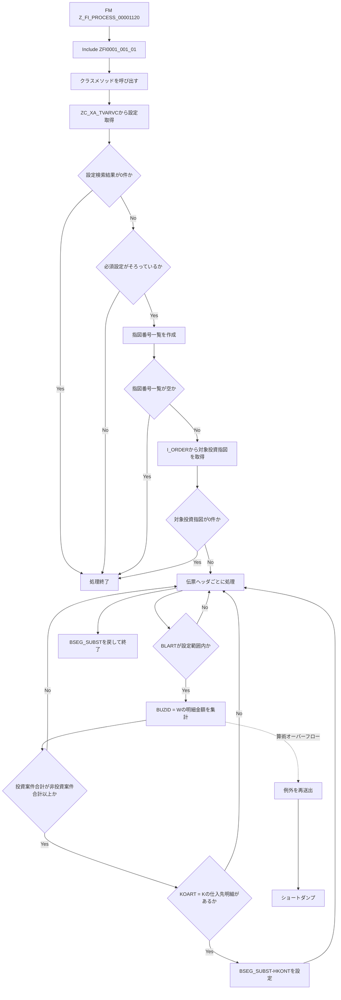

# README

# 要件書

## 業務要件

- [ ] 要確認

## 機能要件

入力：Function Module Z_FI_PROCESS_00001120 の T_BKPF、T_BSEG、T_BSEGSUB 等を受け取る。

出力：条件を満たす場合、置換用明細 BSEG_SUBST の HKONT に設定済み買掛金勘定を設定する。

処理条件：設定された伝票タイプ・投資指図タイプ・買掛金勘定がそろい、対象投資指図を取得できること。投資案件金額が非投資案件金額以上の場合に仕入先明細の勘定を置換する。

機能上の制約：設定不足、指図番号なし、対象投資指図なしの場合は処理を終了する。算術オーバーフローは例外として伝播し、Include でショートダンプとして再送出する。

## 業務フロー

- [ ] 要確認

# 概要書

## 処理概要

Function Module Z_FI_PROCESS_00001120 から Include ZFI0001_001_01 を経由し、クラス ZCLFI0001_001_01 の静的メソッドを呼び出す。

CDS ZC_XA_TVARVC から伝票タイプ、投資指図タイプ、買掛金勘定の設定を取得する。必須設定が不足する場合は処理を終了する。

会計伝票明細から指図番号を抽出し、I_ORDER で対象投資指図を取得する。対象伝票の前払金明細を投資案件分と非投資案件分に集計し、投資案件分が同額以上なら仕入先明細の HKONT を置換する。

### 1. 機能概要

- **機能名：** Equipment Accounts Payable Control Account Substitution（設備買掛金統制勘定の置換）
- **処理方式：** Function Module から Include を介して独自クラスの静的メソッドを呼び出す同期処理。
- **処理概要：** 前払金明細を投資指図の有無で分類して金額を比較し、条件を満たす伝票の仕入先明細に設定済み買掛金勘定を設定する。

### 2. 処理詳細

1. **入口からクラスメソッドを呼び出す**
   - Function Module Z_FI_PROCESS_00001120 が Include ZFI0001_001_01 を実行する。
   - Include は ZCLFI0001_001_01=>Z_FI_PROCESS_00001120 を呼び出し、T_BKPF、T_BSEG、T_BSEGSUB を渡す。
   - CX_SY_ARITHMETIC_OVERFLOW は Include で RAISE SHORTDUMP により再送出する。
2. **設定情報を取得する**
   - ZC_XA_TVARVC から Z_FI_PROCESS_00001120_BLART、Z_FI_PROCESS_00001120_AUART、Z_FI_PROCESS_00001120_HKONT の設定を取得する。
   - 検索結果が0件、または伝票タイプ・投資指図タイプ・買掛金勘定のいずれかが初期値なら RETURN する。
3. **投資指図を特定する**
   - T_BSEG の AUFNR から重複を除いた指図番号一覧を作り、初期値を除外する。
   - 一覧が空なら RETURN する。
   - I_ORDER から指図番号および設定済み投資指図タイプに一致する指図を取得する。取得結果が0件なら RETURN する。
4. **前払金明細の金額を集計する**
   - BSEG_SUBST を作業用内部テーブルに複製する。
   - 伝票ヘッダの BLART が設定範囲外の場合は、その伝票をスキップする。
   - 会社コード・伝票番号・会計年度が一致し BUZID が 'W' の明細を対象に、対象投資指図の有無で DMBTR を投資案件合計または非投資案件合計に加算する。
   - 金額加算で算術オーバーフローが発生した場合は CX_SY_ARITHMETIC_OVERFLOW を再送出する。
5. **仕入先明細の勘定を置換する**
   - 投資案件合計が非投資案件合計を下回る場合は当該伝票をスキップする。
   - 会社コード・伝票番号・会計年度が一致し KOART が 'K' の明細を検索する。
   - 仕入先明細を特定できた場合、その行に対応する BSEG_SUBST-HKONT に設定済み買掛金勘定を設定する。
   - ループ終了後、作業用内部テーブルを BSEG_SUBST に戻す。

### 3. 処理条件

| No. | 判定対象 | 判定条件 | 条件成立時の処理 | 条件不成立時の処理 |
| --- | --- | --- | --- | --- |
| 1 | ZC_XA_TVARVC検索結果 | 検索結果が0件 | RETURNで処理を終了する。 | 取得した設定行を分類する。 |
| 2 | 必須設定 | 伝票タイプ・投資指図タイプ・買掛金勘定のいずれかが初期値 | RETURNで処理を終了する。 | 指図番号一覧を作成する。 |
| 3 | 指図番号一覧 | 初期値を除外した後に一覧が空 | RETURNで処理を終了する。 | I_ORDERから対象投資指図を検索する。 |
| 4 | 対象投資指図 | 設定タイプに一致するI_ORDERが0件 | RETURNで処理を終了する。 | 伝票ヘッダの処理を開始する。 |
| 5 | 伝票タイプ | BLARTが設定範囲外 | 当該伝票をスキップする。 | 前払金明細を集計する。 |
| 6 | 前払金明細 | 伝票キーが一致し BUZID = 'W' | 投資指図の有無に応じた金額合計へ加算する。 | 当該明細を集計対象としない。 |
| 7 | 金額比較 | 投資案件合計が非投資案件合計を下回る | 当該伝票の勘定置換をスキップする。 | 仕入先明細を検索する。 |
| 8 | 仕入先明細 | 一致する KOART = 'K' の明細が存在する | 対応する BSEG_SUBST-HKONT を設定する。 | 勘定置換を行わない。 |
| 9 | 金額加算 | 算術オーバーフローが発生する | 例外を再送出し、Includeでショートダンプとする。 | 集計を継続する。 |

### 4. 処理概要図

## 前提/制約条件

### **前提条件：**

- 設定情報：ZC_XA_TVARVC に伝票タイプ（Z_FI_PROCESS_00001120_BLART）、投資指図タイプ（Z_FI_PROCESS_00001120_AUART）、買掛金勘定（Z_FI_PROCESS_00001120_HKONT）の設定が必要。
- 入力データ：Function Module に会計伝票ヘッダ T_BKPF、会計伝票明細 T_BSEG、置換対象 T_BSEGSUB が渡されること。
- 業務データ：I_ORDER から入力明細の指図番号と設定済み投資指図タイプに一致する指図を取得できること。

### **制約条件：**

- 処理対象：BLART が設定された伝票タイプ範囲に含まれる会計伝票ヘッダ。
- 明細対象：伝票キーが一致し BUZID が 'W' の明細を金額集計の対象とする。
- 勘定置換条件：投資案件合計が非投資案件合計以上で、KOART が 'K' の仕入先明細を特定できる場合に限り HKONT を設定する。
- 処理終了条件：設定不足、指図番号一覧が空、または対象投資指図が取得できない場合は RETURN で終了する。
- 例外条件：金額加算時の算術オーバーフローは例外として伝播し、Include でショートダンプとして再送出する。

## 依存関係

| **オブジェクト名** | **種類** | **用途** |
| --- | --- | --- |
| Z_FI_PROCESS_00001120 | Function Module | 処理の入口としてInclude ZFI0001_001_01を実行する。 |
| ZFI0001_001_01 | Include | 独自クラスの静的メソッドを呼び出し、算術オーバーフローをショートダンプとして再送出する。 |
| ZCLFI0001_001_01 | 独自クラス | 設定取得、投資指図判定、金額集計、HKONT設定を実装する。 |
| ZABSEG_SUBST1 | Append Structure | BSEG_SUBSTにHKONT項目を追加する。 |
| CX_SY_ARITHMETIC_OVERFLOW | 例外クラス | 金額加算時の算術オーバーフローを通知する。 |
| BKPF | DDIC構造 | 会計伝票ヘッダの行型として使用し、伝票キーおよび伝票タイプを参照する。 |
| BSEG | DDIC構造 | 会計伝票明細の行型として使用し、指図番号・明細区分・金額・勘定タイプを参照する。 |
| BSEG_SUBST | DDIC構造 | 勘定置換用明細の型として使用し、HKONTを設定する。 |
| BKDF | DDIC構造 | Function Moduleの任意入力パラメータI_BKDFの型。 |
| BKDF_SUBST | DDIC構造 | Function Moduleの任意変更パラメータI_BKDFSUBの型。 |
| BKPF_SUBST | DDIC構造 | Function ModuleのテーブルパラメータT_BKPF_SUBSTの行型。 |
| BSEC | DDIC構造 | Function Moduleの任意テーブルパラメータT_BSECの行型。 |

### 使用公開API

| **API名** | **種類** | **用途** |
| --- | --- | --- |
| ZC_XA_TVARVC | CDS View | 3種類の処理設定を取得する。 |
| I_ORDER | CDS View | 指図番号と投資指図タイプを照合して対象指図を取得する。 |

## 補足情報

### **メッセージ**

| **エラーケース** | **メッセージ** | **引数** | **補足** | **クラス** |
| --- | --- | --- | --- | --- |
| - | - | - | - | - |

### データモデル・項目情報

| **オブジェクト名** | **項目名** | **用途** | **処理内容** |
| --- | --- | --- | --- |
| ZC_XA_TVARVC | NAME / SIGN / OPTI / LOW / HIGH | 設定名、選択条件、設定値。 | NAMEを3種類の設定名で絞り込み、SIGN・OPTI・LOW・HIGHを設定範囲に格納し、HKONT設定値を取得する（参照）。 |
| I_ORDER | ORDERID / ORDERTYPE | 投資指図の特定。 | 会計明細のAUFNR由来のORDERIDと設定されたORDERTYPEで対象指図を抽出する（参照）。 |
| T_BKPF / BKPF | BUKRS / BELNR / GJAHR / BLART | 伝票識別と伝票タイプ判定。 | 伝票キーで明細を絞り込み、BLARTを設定範囲と比較する（参照）。 |
| T_BSEG / BSEG | BUKRS / BELNR / GJAHR / BUZID / AUFNR / DMBTR / KOART | 前払金明細の抽出、金額集計、仕入先明細の検索。 | BUZID = 'W'の明細を投資指図の有無で分類してDMBTRを集計し、KOART = 'K'の明細を検索する（参照）。 |
| T_BSEGSUB / BSEG_SUBST | HKONT / TABIX | 勘定置換用明細の保持と行特定。 | 作業用内部テーブルの対象行にHKONTを設定して戻す（更新）。 |
| ZABSEG_SUBST1 | HKONT | BSEG_SUBSTに追加された総勘定元帳勘定項目。 | 設定済み買掛金勘定を格納する（更新）。 |
| T_BKPF_SUBST / T_BSEC | テーブルパラメータの行構造 | Function Moduleインターフェースのパラメータ。 | 本処理コード内では直接参照・更新しない。 |

### 例外処理

- **データ取得結果が0件の場合：** ZC_XA_TVARVCの検索結果が0件、またはI_ORDERの対象投資指図が0件の場合はRETURNで終了する。
- **設定情報が取得できない場合：** 伝票タイプ、投資指図タイプ、買掛金勘定のいずれかが初期値の場合はRETURNで終了する。
- **対象条件を満たさない場合：** 伝票タイプが設定範囲外、投資案件合計が非投資案件合計を下回る、または仕入先明細を特定できない場合は勘定置換しない。
- **例外発生時：** 金額加算時のCX_SY_ARITHMETIC_OVERFLOWを再送出し、IncludeでRAISE SHORTDUMPによりショートダンプとして再送出する。
- **その他：** 指図番号一覧が空の場合はRETURNで終了する。通常の条件不成立ではエラーメッセージを出力しない。

# テスト仕様書
## テスト仕様

| **大項目No.** | **小項目No.** | **テストケース（大項目）** | **テストケース（小項目）** | **確認内容・期待結果** |
| --- | --- | --- | --- | --- |
| 1 | 1-1 | 設定情報取得 | 必要な設定がすべて存在する | 3種類の設定が取得され、後続処理へ進むこと。 |
| 1 | 1-2 | 設定情報取得 | 設定CDSの検索結果が0件 | RETURNで終了し、HKONTを変更しないこと。 |
| 1 | 1-3 | 設定情報取得 | 必須設定のいずれかが初期値 | RETURNで終了し、勘定置換を行わないこと。 |
| 2 | 2-1 | 投資指図判定 | 指図番号一覧が空 | RETURNで終了すること。 |
| 2 | 2-2 | 投資指図判定 | 設定タイプに一致する投資指図が存在する | 対象指図を取得し、金額集計へ進むこと。 |
| 2 | 2-3 | 投資指図判定 | 対象投資指図が0件 | RETURNで終了し、勘定置換を行わないこと。 |
| 3 | 3-1 | 伝票タイプ判定 | BLARTが設定範囲内 | 対象伝票の前払金明細を集計すること。 |
| 3 | 3-2 | 伝票タイプ判定 | BLARTが設定範囲外 | 当該伝票をスキップすること。 |
| 4 | 4-1 | 前払金明細集計 | 伝票キーが一致しBUZIDがW | 対象明細金額が投資案件または非投資案件の合計へ加算されること。 |
| 4 | 4-2 | 前払金明細集計 | BUZIDがW以外、または伝票キーが不一致 | 当該明細を集計対象としないこと。 |
| 4 | 4-3 | 金額比較 | 投資案件合計が非投資案件合計を下回る | 勘定置換をスキップすること。 |
| 4 | 4-4 | 金額比較 | 投資案件合計と非投資案件合計が同額 | 金額条件を満たし、仕入先明細検索へ進むこと。 |
| 4 | 4-5 | 金額比較 | 投資案件合計が非投資案件合計を上回る | 金額条件を満たし、仕入先明細検索へ進むこと。 |
| 5 | 5-1 | 勘定置換 | KOARTがKの仕入先明細が存在する | 対応するBSEG_SUBST-HKONTに設定済み勘定が設定されること。 |
| 5 | 5-2 | 勘定置換 | KOARTがKの仕入先明細が存在しない | HKONTを置換しないこと。 |
| 6 | 6-1 | 例外処理 | 金額加算で算術オーバーフローが発生する | 例外が再送出され、Includeでショートダンプとなること。 |
