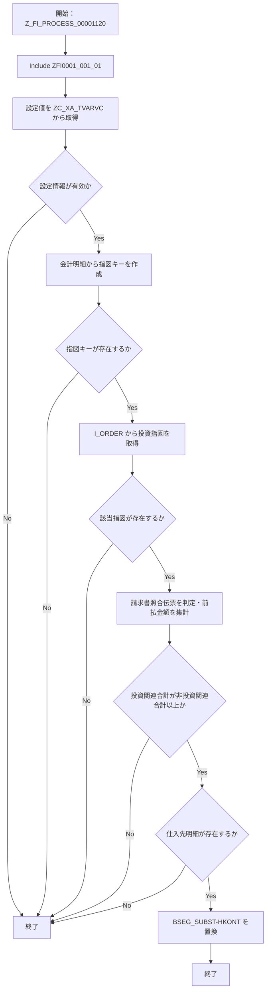

# README

# 要件書

## 業務要件

- [ ] 要確認

## 機能要件

入力：会計伝票ヘッダ（BKPF）、明細（BSEG）、代入用明細（BSEG_SUBST）。

出力：条件を満たす仕入先明細の買掛金勘定（HKONT）を代入する。

処理条件：設定値から請求書照合伝票タイプ、投資指図タイプ、買掛金勘定を取得し、前払明細の投資関連金額が非投資関連金額以上の場合に処理する。

制約：必須設定または対象指図が取得できない場合は更新せず終了する。

## 業務フロー

- [ ] 要確認

# 概要書

## 処理概要

Function Module Z_FI_PROCESS_00001120 から Include ZFI0001_001_01 を介してクラス ZCLFI0001_001_01 を呼び出し、条件を満たす会計伝票の仕入先明細に買掛金勘定を代入する。

### 1. 機能概要

- **機能名：** Equipment Accounts Payable Control Account Substitution
- **処理方式：** Function Module から Include 経由でクラスメソッドを呼び出す同期処理
- **処理概要：** 設定値と投資指図を参照し、請求書照合伝票の前払金明細を集計して条件を満たす場合に仕入先明細の HKONT を置換する。

### 2. 処理詳細

1. **Function Module から Include を呼び出す**
   - Z_FI_PROCESS_00001120 が ZFI0001_001_01 を INCLUDE する。
2. **設定情報を取得する**
   - ZC_XA_TVARVC から請求書照合伝票タイプ、投資指図タイプ、買掛金勘定の設定を取得する。
   - 設定が0件、または必須設定が不足する場合は RETURN する。
3. **投資指図を抽出する**
   - 会計明細から AUFNR を重複排除して収集し、空の指図を除外する。
   - I_ORDER から設定された投資指図タイプに一致する指図を取得し、該当がなければ RETURN する。
4. **伝票を判定して金額を集計する**
   - 請求書照合伝票タイプ以外のヘッダはスキップする。
   - BUZID = 'W' の明細を投資指図に該当するかで分類し、DMBTR を投資関連・非投資関連に集計する。
5. **買掛金勘定を代入する**
   - 投資関連合計が非投資関連合計未満ならスキップする。
   - KOART = 'K' の明細が存在する場合、対応する BSEG_SUBST-HKONT に設定済み買掛金勘定を代入する。
6. **算術例外を処理する**
   - CX_SY_ARITHMETIC_OVERFLOW は再送出され、Include 側で SHORTDUMP となる。

### 3. 処理条件

| No. | 判定対象 | 判定条件 | 条件成立時の処理 | 条件不成立時の処理 |
|---|---|---|---|---|
| 1 | 設定情報の取得件数 | ZC_XA_TVARVC の検索結果が0件 | 処理を終了する | 設定値を解析する |
| 2 | 必須設定値 | 請求書照合伝票タイプ、投資指図タイプ、買掛金勘定のいずれかが未設定 | 処理を終了する | 指図キーを作成する |
| 3 | 指図キー | 会計明細から取得した指図キーが空 | 処理を終了する | I_ORDER を検索する |
| 4 | 投資指図の検索結果 | I_ORDER に該当指図がない | 処理を終了する | 伝票明細を処理する |
| 5 | 伝票タイプ | 伝票タイプが請求書照合設定範囲に含まれない | 当該ヘッダをスキップする | 金額を集計する |
| 6 | 投資関連金額 | 投資関連合計が非投資関連合計未満 | 当該伝票をスキップする | 仕入先明細を検索する |
| 7 | 仕入先明細 | KOART = 'K' の明細が存在する | 対応する HKONT を置換する | HKONT を変更しない |
| 8 | 金額加算 | 算術オーバーフローが発生する | 例外を再送出し SHORTDUMP する | 集計を続行する |

### 4. 処理概要図

## 前提/制約条件

### **前提条件：**

- 設定情報：ZC_XA_TVARVC に Z_FI_PROCESS_00001120_BLART、Z_FI_PROCESS_00001120_AUART、Z_FI_PROCESS_00001120_HKONT の設定が必要。
- データ：会計伝票ヘッダ・明細と代入用明細が呼出元から渡される。

### **制約条件：**

- 対象条件：伝票タイプが請求書照合設定範囲に含まれ、前払金明細（BUZID = 'W'）が集計対象となる伝票を処理する。
- 対象条件：投資関連合計が非投資関連合計以上である場合のみ勘定を置換する。
- データ不足時：必須設定、指図キー、投資指図が取得できない場合は処理を終了する。

## 依存関係

| **オブジェクト名** | **種類** | **用途** |
|---|---|---|
| Z_FI_PROCESS_00001120 | Function Module | 処理の入口で Include を呼び出す。 |
| ZFI0001_001_01 | Include | クラスメソッドを呼び出し、算術例外を SHORTDUMP にする。 |
| ZCLFI0001_001_01 | Class | 設定取得、指図検索、金額集計、勘定置換を実装する。 |
| BSEG_SUBST | DDIC structure | 仕入先明細の HKONT 代入先構造。 |
| ZABSEG_SUBST1 | Append structure | BSEG_SUBST に HKONT 項目を追加する。 |
| CX_SY_ARITHMETIC_OVERFLOW | Exception class | 金額加算の算術オーバーフローを通知する。 |

### 使用公開API

| **API名** | **種類** | **用途** |
|---|---|---|
| ZC_XA_TVARVC | CDS view | 処理条件となる設定値を取得する。 |
| I_ORDER | CDS view | 投資指図の指図番号と指図タイプを検索する。 |

## 補足情報

## 補足情報

### **メッセージ**

| **エラーケース** | **メッセージ** | **引数** | **補足** | **クラス** |
|---|---|---|---|---|
| - | - | - | - | - |

### データモデル・項目情報

| **オブジェクト名** | **項目名** | **用途** | **処理内容** |
|---|---|---|---|
| BKPF | BUKRS, BELNR, GJAHR, BLART | 会計伝票の識別子と伝票タイプ。 | 伝票明細を関連付け、対象伝票タイプを判定する（参照）。 |
| BSEG | BUKRS, BELNR, GJAHR, BUZID, AUFNR, DMBTR, KOART | 会計伝票明細の識別、前払金区分、指図、金額、勘定タイプ。 | 指図キー作成、前払金額集計、仕入先明細検索に使用する（参照）。 |
| BSEG_SUBST | HKONT, TABIX | 代入対象明細の勘定と元明細インデックス。 | 該当仕入先明細の HKONT を設定する（更新）。 |
| ZC_XA_TVARVC | NAME, SIGN, OPTI, LOW, HIGH | 選択条件および買掛金勘定の設定値。 | 必須設定を取得し、選択範囲を構築する（参照）。 |
| I_ORDER | ORDERID, ORDERTYPE | 投資指図の番号と指図タイプ。 | 投資指図タイプに一致する指図を抽出する（参照）。 |

### 例外処理

- **データ取得結果が0件の場合：** 設定情報、または I_ORDER の該当指図が0件の場合は RETURN して処理を終了する。
- **設定情報が取得できない場合：** 必須設定値が不足している場合は RETURN して更新しない。
- **対象条件を満たさない場合：** 対象伝票タイプ以外、または投資関連合計が非投資関連合計未満の場合は当該伝票をスキップする。
- **例外発生時：** CX_SY_ARITHMETIC_OVERFLOW を再送出し、Include 側で RAISE SHORTDUMP する。
- **その他：** 仕入先明細（KOART = 'K'）が存在しない場合、勘定置換を行わない。

# テスト仕様書
## テスト仕様

| **大項目No.** | **小項目No.** | **テストケース（大項目）** | **テストケース（小項目）** | **確認内容・期待結果** |
|---|---|---|---|---|
| 1 | 1-1 | 設定情報取得 | 3種類の必須設定が存在する | 設定値が取得され、後続処理に進む。 |
| 1 | 1-2 | 設定情報取得 | 設定検索結果が0件 | RETURN で処理終了し、勘定を更新しない。 |
| 1 | 1-3 | 設定情報取得 | 必須設定のいずれかが不足する | RETURN で処理終了し、勘定を更新しない。 |
| 2 | 2-1 | 投資指図検索 | 会計明細に指図キーが存在し、設定タイプに一致する指図がある | 該当投資指図を取得し、後続処理に進む。 |
| 2 | 2-2 | 投資指図検索 | 指図キーが空 | RETURN で処理終了する。 |
| 2 | 2-3 | 投資指図検索 | 該当する投資指図がない | RETURN で処理終了する。 |
| 3 | 3-1 | 伝票タイプ判定 | 伝票タイプが設定範囲に含まれる | 前払金明細の集計処理を行う。 |
| 3 | 3-2 | 伝票タイプ判定 | 伝票タイプが設定範囲に含まれない | 当該伝票ヘッダをスキップする。 |
| 4 | 4-1 | 金額判定・勘定置換 | 投資関連合計が非投資関連合計以上で仕入先明細がある | 対応する BSEG_SUBST-HKONT が設定済み買掛金勘定に置換される。 |
| 4 | 4-2 | 金額判定・勘定置換 | 投資関連合計が非投資関連合計未満 | 当該伝票をスキップし、勘定を置換しない。 |
| 4 | 4-3 | 金額判定・勘定置換 | 条件を満たすが仕入先明細がない | 勘定置換を行わない。 |
| 5 | 5-1 | 例外処理 | 金額加算で算術オーバーフローが発生する | 例外を再送出し、SHORTDUMP となる。 |
