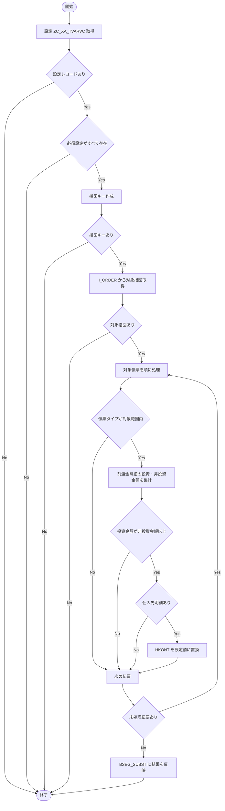

# README

# 要件書

## 業務要件

- [ ] 要確認

## 機能要件

入力：Function Module Z_FI_PROCESS_00001120 は会計伝票ヘッダ（T_BKPF）、明細（T_BSEG）、置換用明細（T_BSEGSUB）等を受け取る。クラスメソッドは会計伝票ヘッダと明細を入力し、BSEG_SUBST を変更する。

出力：条件を満たす仕入先明細の HKONT を、設定 Z_FI_PROCESS_00001120_HKONT の LOW 値に置換する。条件を満たさない場合、または必要設定・対象指図がない場合は置換処理を行わず戻る。

処理条件：設定 Z_FI_PROCESS_00001120_BLART（対象伝票タイプ）、Z_FI_PROCESS_00001120_AUART（対象投資指図タイプ）、Z_FI_PROCESS_00001120_HKONT（買掛金勘定）を取得し、すべて有効な場合に処理する。対象伝票の前渡金明細（BUZID = 'W'）について、投資指図分金額が非投資指図分金額以上の場合に置換する。

機能上の制約：パッケージ内のソースから確認できる処理のみを記載する。SAP システム上のカスタマイズ値や実行結果は確認していない。

## 業務フロー

- [ ] 要確認

# 概要書

## 処理概要

Function Module Z_FI_PROCESS_00001120 から Include ZFI0001_001_01 を通じてクラス ZCLFI0001_001_01 の静的メソッドを呼び出し、会計伝票の買掛金勘定置換を行う。

メソッドは TVARVC 互換 CDS ビュー ZC_XA_TVARVC から対象伝票タイプ・投資指図タイプ・買掛金勘定の設定を読み込む。設定不足、対象投資指図なし、または対象指図キーなしの場合は処理を終了する。

対象伝票の前渡金明細を投資指図・非投資指図に分類して金額を集計し、投資指図分が非投資指図分以上のとき、同一伝票の仕入先明細の HKONT を設定済み買掛金勘定に置換する。算術オーバーフローは例外として呼出元に伝播し、Include で SHORTDUMP となる。

### 1. 機能概要

- **機能名：** Equipment Accounts Payable Control Account Substitution（コードコメント）
- **処理方式：** Function Module から Include を介して呼び出す ABAP クラスの静的メソッド
- **処理概要：** 設定された伝票タイプ・投資指図タイプ・買掛金勘定を使用し、前渡金明細の投資指図金額を比較して仕入先明細の HKONT を置換する。

### 2. 処理詳細

1. **Function Module から Include を呼び出す**
   - Z_FI_PROCESS_00001120 が ZFI0001_001_01 を INCLUDE する。
   - Include は T_BKPF、T_BSEG、T_BSEGSUB をクラスメソッドへ渡す。
2. **設定情報を取得・判定する**
   - ZC_XA_TVARVC から BLART、AUART、HKONT に対応する設定を取得する。
   - 設定が0件、または対象伝票タイプ範囲・投資指図タイプ範囲・買掛金勘定のいずれかが未設定の場合は戻る。
3. **投資指図キーを作成し対象指図を取得する**
   - 会計明細の AUFNR から重複を除いた指図キーを作成し、初期値を削除する。
   - 指図キーが空、または I_ORDER から対象 OrderType の指図を取得できない場合は戻る。
4. **対象伝票の前渡金明細を集計する**
   - 伝票タイプが設定された対象範囲外の場合、その伝票をスキップする。
   - BUZID = 'W' の明細を対象に、I_ORDER に存在する指図の DMBTR を投資指図合計、それ以外を非投資指図合計に加算する。
   - 金額加算で CX_SY_ARITHMETIC_OVERFLOW が発生した場合は例外を再送出する。
5. **買掛金勘定を置換する**
   - 投資指図合計が非投資指図合計より小さい場合は置換せず次の伝票へ進む。
   - 条件を満たす場合、同一伝票の KOART = 'K' の明細を検索し、該当行があれば BSEG_SUBST-HKONT に設定済み買掛金勘定を設定する。
   - 全伝票の処理後、更新した置換明細テーブルを BSEG_SUBST に戻す。

### 3. 処理条件

| No. | 判定対象 | 判定条件 | 条件成立時の処理 | 条件不成立時の処理 |
|---|---|---|---|---|
| 1 | 設定取得結果 | ZC_XA_TVARVC から対象設定が1件以上取得できる | 設定値の編集を続行する | メソッドを終了する |
| 2 | 必須設定 | BLART 範囲、AUART 範囲、HKONT がすべて設定済み | 指図キーを作成する | メソッドを終了する |
| 3 | 指図キー | 会計明細から作成した指図キーが空でない | I_ORDER から対象指図を取得する | メソッドを終了する |
| 4 | 対象指図取得 | I_ORDER から対象 OrderType の指図が取得できる | 会計伝票の処理を続ける | メソッドを終了する |
| 5 | 伝票タイプ | 会計伝票ヘッダの BLART が設定範囲内 | 前渡金明細を集計する | 当該伝票をスキップする |
| 6 | 前渡金明細 | 明細の BUZID が 'W' と一致する | 指図の有無に応じて金額を集計する | 集計対象にしない |
| 7 | 投資指図判定 | 明細 AUFNR が取得済み対象指図に存在する | DMBTR を投資指図合計に加算する | DMBTR を非投資指図合計に加算する |
| 8 | 金額比較 | 投資指図合計が非投資指図合計以上 | 仕入先明細の HKONT 置換を試みる | 当該伝票をスキップする |
| 9 | 仕入先明細 | 同一伝票に KOART = 'K' の明細が存在する | 該当行の HKONT を置換する | HKONT を変更しない |
| 10 | 金額加算 | 算術オーバーフローが発生する | CX_SY_ARITHMETIC_OVERFLOW を再送出し、Include で SHORTDUMP | 集計を続ける |

### 4. 処理概要図

## 前提/制約条件

### **前提条件：**

- 設定情報：ZC_XA_TVARVC に対象伝票タイプ Z_FI_PROCESS_00001120_BLART、投資指図タイプ Z_FI_PROCESS_00001120_AUART、買掛金勘定 Z_FI_PROCESS_00001120_HKONT が必要。
- 入力データ：会計伝票ヘッダ、会計伝票明細および置換用明細テーブルが呼出元から渡される。
- 参照データ：I_ORDER に対象投資指図が登録されている必要がある。

### **制約条件：**

- 処理対象：BLART が設定された対象伝票タイプ範囲内の会計伝票。
- 明細条件：金額集計対象は BUZID = 'W' の前渡金明細。
- 指図条件：AUFNR が I_ORDER から取得した対象投資指図に該当する場合に投資指図分として集計する。
- 置換条件：投資指図合計が非投資指図合計以上であり、同一伝票に KOART = 'K' の明細がある場合に HKONT を置換する。
- 設定不足、指図キーなし、対象指図取得結果0件の場合はメソッドを終了し、置換処理を行わない。
- 算術オーバーフロー発生時は例外を再送出し、呼出元 Include で SHORTDUMP する。

## 依存関係

| **オブジェクト名** | **種類** | **用途** |
|---|---|---|
| Z_FI_PROCESS_00001120 | Function Module | 処理の入口となり Include を呼び出す。 |
| ZFI0001_001_01 | Include | クラスメソッドを呼び出し、算術オーバーフローを SHORTDUMP にする。 |
| ZCLFI0001_001_01 | Class | 設定取得、対象指図判定、金額集計および HKONT 置換を実装する。 |
| BSEG_SUBST | DDIC structure | 置換対象明細データを保持し、HKONT を更新する。 |
| ZABSEG_SUBST1 | Append structure extension | BSEG_SUBST に HKONT 項目を追加する拡張定義。 |
| CX_SY_ARITHMETIC_OVERFLOW | Exception class | 金額加算時の算術オーバーフローを通知する。 |

### 使用公開API

| **API名** | **種類** | **用途** |
|---|---|---|
| ZC_XA_TVARVC | CDS view | 処理対象伝票タイプ、投資指図タイプおよび買掛金勘定の設定を取得する。 |
| I_ORDER | CDS view | 指図 ID と指図タイプを参照し、対象投資指図を特定する。 |

## 補足情報

### **メッセージ**

| **エラーケース** | **メッセージ** | **引数** | **補足** | **クラス** |
|---|---|---|---|---|

### データモデル・項目情報

| **オブジェクト名** | **項目名** | **用途** | **処理内容** |
|---|---|---|---|
| ZC_XA_TVARVC | NAME / SIGN / OPTI / LOW / HIGH | 選択条件・範囲設定および買掛金勘定の設定値 | 参照 |
| I_ORDER | ORDERID / ORDERTYPE | 対象投資指図の識別と指図タイプ判定 | 参照 |
| BKPF | BUKRS / BELNR / GJAHR / BLART | 会計伝票の識別および伝票タイプ判定 | 参照 |
| BSEG | BUKRS / BELNR / GJAHR / BUZID / AUFNR / DMBTR / KOART | 前渡金明細の抽出、指図分類・金額集計および仕入先明細の特定 | 参照 |
| BSEG_SUBST | HKONT | 置換後の買掛金勘定 | 更新 |

### 例外処理

- **データ取得結果が0件の場合：** ZC_XA_TVARVC の取得結果が0件、指図キーが空、または I_ORDER から対象指図が取得できない場合はメソッドを終了する。
- **設定情報が取得できない場合：** 必須設定のいずれかが未設定の場合はメソッドを終了する。
- **対象条件を満たさない場合：** 対象外 BLART の伝票、投資指図合計が非投資指図合計より小さい伝票、または仕入先明細がない場合は HKONT を置換しない。
- **例外発生時：** 金額加算時の CX_SY_ARITHMETIC_OVERFLOW を再送出し、Include で RAISE SHORTDUMP する。
- **その他：** -

# テスト仕様書
## テスト仕様

| **大項目No.** | **小項目No.** | **テストケース（大項目）** | **テストケース（小項目）** | **確認内容・期待結果** |
|---|---|---|---|---|
| 1 | 1-1 | 設定情報の確認 | 必須設定がすべて取得できる | 設定範囲と買掛金勘定を読み込み、後続処理へ進む。 |
| 1 | 1-2 | 設定情報の確認 | 設定レコードが取得できない | メソッドが終了し、HKONT を置換しない。 |
| 1 | 1-3 | 設定情報の確認 | BLART 範囲、AUART 範囲、HKONT のいずれかが未設定 | メソッドが終了し、HKONT を置換しない。 |
| 2 | 2-1 | 対象指図の確認 | 明細から有効な指図キーが作成される | 対象指図取得処理を実行する。 |
| 2 | 2-2 | 対象指図の確認 | 指図キーが空である | メソッドが終了する。 |
| 2 | 2-3 | 対象指図の確認 | 対象 OrderType の指図が取得できない | メソッドが終了する。 |
| 3 | 3-1 | 伝票対象判定 | BLART が設定範囲内である | 対象伝票の前渡金明細を集計する。 |
| 3 | 3-2 | 伝票対象判定 | BLART が設定範囲外である | 当該伝票をスキップする。 |
| 4 | 4-1 | 前渡金明細の分類 | BUZID が 'W' で対象指図に該当する | DMBTR を投資指図合計に加算する。 |
| 4 | 4-2 | 前渡金明細の分類 | BUZID が 'W' で対象指図に該当しない | DMBTR を非投資指図合計に加算する。 |
| 4 | 4-3 | 前渡金明細の分類 | BUZID が 'W' 以外である | 金額集計対象にしない。 |
| 5 | 5-1 | 金額比較・置換 | 投資指図合計が非投資指図合計より大きい | 仕入先明細が存在すれば HKONT を設定値に置換する。 |
| 5 | 5-2 | 金額比較・置換 | 投資指図合計と非投資指図合計が等しい | 仕入先明細が存在すれば HKONT を設定値に置換する。 |
| 5 | 5-3 | 金額比較・置換 | 投資指図合計が非投資指図合計より小さい | 当該伝票の HKONT を置換しない。 |
| 5 | 5-4 | 金額比較・置換 | 同一伝票に KOART = 'K' の明細がない | HKONT を変更しない。 |
| 6 | 6-1 | 例外処理 | 金額加算時に算術オーバーフローが発生する | CX_SY_ARITHMETIC_OVERFLOW が再送出され、Include で SHORTDUMP となる。 |
