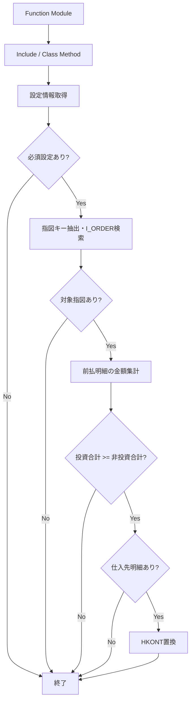

# README

# 要件書

## 業務要件

- [ ] 要確認

## 機能要件

入力：会計伝票ヘッダ、明細、置換用 BSEG_SUBST を受け取る。

出力：条件を満たす仕入先明細の HKONT を設定値に置換する。

処理条件：ZC_XA_TVARVC から伝票タイプ、指図タイプ、買掛金勘定を取得し、投資関連前払金額と非投資関連前払金額を比較する。

制約：必須設定や対象指図がない場合は置換せず終了する。算術オーバーフローは例外として再送出する。

## 業務フロー

- [ ] 要確認

# 概要書

## 処理概要

会計伝票の置換処理で前払明細の金額を投資指図の有無により分類・集計し、投資関連金額が非投資関連金額以上の場合、仕入先明細の勘定コードを設定値に置換する。

### 1. 機能概要

- **機能名：** Equipment Accounts Payable Control Account Substitution
- **処理方式：** Function Module → Include → Class Method の同期処理
- **処理概要：** 設定取得、投資指図抽出、前払明細の金額集計および仕入先明細の HKONT 置換を行う。

### 2. 処理詳細

1. **入口呼び出し**
   - Z_FI_PROCESS_00001120 から ZFI0001_001_01 を実行し、クラスメソッド ZCLFI0001_001_01=>Z_FI_PROCESS_00001120 を呼び出す。

2. **設定取得**
   - ZC_XA_TVARVC から伝票タイプ範囲、投資指図タイプ範囲、買掛金勘定を取得する。
   - 取得結果が0件、または必須設定が不足する場合は RETURN する。

3. **投資指図の抽出**
   - 会計明細から AUFNR を重複排除して取得し、初期値を除外する。
   - I_ORDER から設定された OrderType に該当する指図を取得する。該当なしの場合は RETURN する。

4. **金額集計と置換**
   - 設定範囲外の伝票タイプをスキップし、BUZID = W の明細を投資関連・非投資関連に分類して DMBTR を集計する。
   - 投資関連合計が非投資関連合計以上で、KOART = K の仕入先明細が存在する場合、対応する BSEG_SUBST-HKONT を設定値に置換する。
   - 算術オーバーフローは Include で SHORTDUMP として再送出する。

### 3. 処理条件

| No. | 判定対象 | 判定条件 | 条件成立時の処理 | 条件不成立時の処理 |
|---|---|---|---|---|
| 1 | 必須設定 | 伝票タイプ、指図タイプ、買掛金勘定が設定済み | 後続処理へ進む | 置換せず終了 |
| 2 | 指図キー | 有効な AUFNR が存在する | I_ORDER を検索 | 終了 |
| 3 | 対象指図 | I_ORDER に該当指図が存在する | 明細集計へ進む | 終了 |
| 4 | 伝票タイプ | BLART が設定範囲内 | 明細を集計 | ヘッダをスキップ |
| 5 | 金額比較 | 投資合計 >= 非投資合計 | 仕入先明細を確認 | 伝票をスキップ |
| 6 | 仕入先明細 | KOART = K の明細が存在する | HKONT を置換 | 置換しない |

### 4. 処理概要図

## 前提/制約条件

### **前提条件：**

設定情報：ZC_XA_TVARVC に伝票タイプ範囲、投資指図タイプ範囲、買掛金勘定が必要。

入力データ：会計伝票ヘッダ、明細および BSEG_SUBST が呼び出し元から渡される。

拡張設定：ZABSEG_SUBST1 が BSEG_SUBST に HKONT を追加する。

### **制約条件：**

対象条件：設定範囲内の BLART および BUZID = W の前払明細。

置換条件：投資関連前払金額合計が非投資関連前払金額合計以上であること。

制約：設定・指図・仕入先明細がない場合は置換しない。

## 依存関係

| **オブジェクト名** | **種類** | **用途** |
|---|---|---|
| Z_FI_PROCESS_00001120 | Function Module | 入口となり Include を呼び出す。 |
| ZFI0001_001_01 | Include | クラスメソッドを呼び出し、算術オーバーフローを SHORTDUMP にする。 |
| ZCLFI0001_001_01 | Class | 勘定コード置換ロジックを実装する。 |
| ZABSEG_SUBST1 | Append Structure | BSEG_SUBST に HKONT を追加する。 |
| CX_SY_ARITHMETIC_OVERFLOW | Exception Class | 算術オーバーフローを表す。 |

### 使用公開API

| **API名** | **種類** | **用途** |
|---|---|---|
| ZC_XA_TVARVC | CDS View | 処理条件・勘定コードの設定を取得する。 |
| I_ORDER | CDS View | 指図番号と指図タイプを取得する。 |

## 補足情報

### **メッセージ**

| **エラーケース** | **メッセージ** | **引数** | **補足** | **クラス** |
|---|---|---|---|---|
| - | - | - | - | - |

### データモデル・項目情報

| **オブジェクト名** | **項目名** | **用途** | **処理内容** |
|---|---|---|---|
| BKPF | BUKRS, BELNR, GJAHR, BLART | 伝票識別と伝票タイプ判定。 | 参照 |
| BSEG | BUKRS, BELNR, GJAHR, BUZID, AUFNR, DMBTR, KOART | 前払明細の分類・集計と仕入先明細特定。 | 参照 |
| BSEG_SUBST | HKONT, TABIX | 置換対象の勘定コードと行対応。 | HKONT 更新 |
| ZC_XA_TVARVC | NAME, SIGN, OPTI, LOW, HIGH | 設定値取得。 | 参照 |
| I_ORDER | ORDERID, ORDERTYPE | 投資指図判定。 | 参照 |

### 例外処理

- **データ取得結果が0件の場合：** 設定または I_ORDER の取得結果が0件の場合は RETURN する。
- **設定情報が取得できない場合：** 必須設定が不足する場合は RETURN する。
- **対象条件を満たさない場合：** 伝票タイプ・金額条件を満たさない伝票はスキップする。仕入先明細がなければ置換しない。
- **例外発生時：** CX_SY_ARITHMETIC_OVERFLOW を再送出し、Include で SHORTDUMP とする。
- **その他：** 投資指図キーがない場合は処理を終了する。

# テスト仕様書

## テスト仕様

| **大項目No.** | **小項目No.** | **テストケース（大項目）** | **テストケース（小項目）** | **確認内容・期待結果** |
|---|---|---|---|---|
| 1 | 1-1 | 設定情報 | 必須設定がすべて存在する | 後続処理へ進む。 |
| 1 | 1-2 | 設定情報 | 設定が0件または必須項目が不足する | 置換せず終了する。 |
| 2 | 2-1 | 投資指図 | 有効な AUFNR が存在する | I_ORDER を検索する。 |
| 2 | 2-2 | 投資指図 | 有効な AUFNR が存在しない、または対象指図がない | 処理を終了する。 |
| 3 | 3-1 | 伝票条件 | BLART が設定範囲内である | 前払明細を集計する。 |
| 3 | 3-2 | 伝票条件 | BLART が設定範囲外である | 当該ヘッダをスキップする。 |
| 4 | 4-1 | 金額比較 | 投資合計が非投資合計以上である | 仕入先明細の判定へ進む。 |
| 4 | 4-2 | 金額比較 | 投資合計が非投資合計より小さい | 当該伝票をスキップする。 |
| 5 | 5-1 | 勘定コード置換 | 仕入先明細が存在する | HKONT に設定値を設定する。 |
| 5 | 5-2 | 勘定コード置換 | 仕入先明細が存在しない | 置換しない。 |
| 6 | 6-1 | 例外処理 | 金額加算で算術オーバーフローが発生する | 例外を再送出し SHORTDUMP となる。 |
