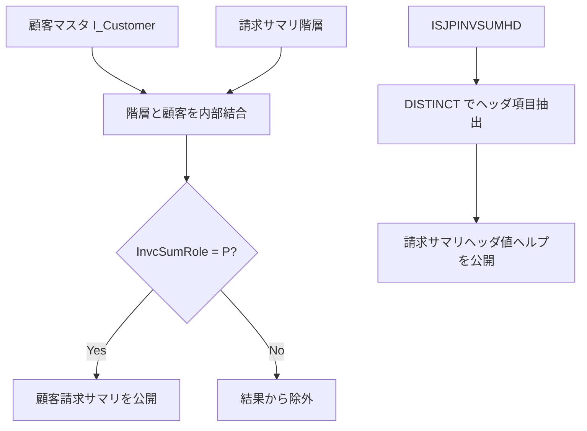

# README

# 要件書

## 業務要件

- [ ] 要確認

## 機能要件

入力：顧客マスタ、請求サマリ階層、請求サマリヘッダの CDS／テーブルデータを参照する。

出力：会社コード・顧客・顧客名による顧客請求サマリ、および会社コード・請求サマリ番号のヘッダ情報を公開する。

処理条件：顧客請求サマリは InvcSumRole = 'P' に限定し、顧客マスタと Customer で内部結合する。ヘッダは DISTINCT で重複を除外する。

制約：定義されているのは読み取り用 CDS View Entity であり、更新処理は含まれない。

## 業務フロー

- [ ] 要確認

# 概要書

## 処理概要

顧客マスタと請求サマリ階層を結合し、ロールが P の顧客請求サマリを提供する。別途、請求サマリヘッダから会社コードと請求サマリ番号を抽出し、消費ビュー／値ヘルプビューとして公開する。

### 1. 機能概要

- **機能名：** Customer Invoice Summary / Invoice Summary Header
- **処理方式：** ABAP CDS View Entity
- **処理概要：** 基礎 CDS とテーブルを参照し、顧客請求サマリおよび請求サマリヘッダの読み取りデータを公開する。

### 2. 処理詳細

1. **顧客マスタと階層データの提供**
   - ZI_FI_Customer が I_Customer から Customer と CustomerName を公開する。
   - ZI_FI_InvcSumHierarch が P_JP_invcsummaryhierarch から CompanyCode、Customer、InvcSumRole を公開する。

2. **顧客請求サマリの生成**
   - ZI_FI_CustInvoiceSum が階層と顧客マスタを Customer で内部結合し、InvcSumRole = 'P' に限定する。
   - ZC_FI_CustInvoiceSum が CompanyCode、Customer、CustomerName を公開する。

3. **請求サマリヘッダの生成**
   - ZI_FI_InvSummaryHeader が ISJPINVSUMHD から会社コードと請求サマリ番号を DISTINCT で取得する。
   - ZC_FI_InvSummaryHeader が項目を CompanyCode、InvNum として公開し、値ヘルプ用ビューとして定義される。

### 3. 処理条件

| No. | 判定対象 | 判定条件 | 条件成立時の処理 | 条件不成立時の処理 |
|---|---|---|---|---|
| 1 | 階層ロール | InvcSumRole = 'P' | 顧客請求サマリの対象とする | 結果から除外する |
| 2 | 顧客マスタ結合 | 階層 Customer と顧客マスタ Customer が一致する | 顧客名を含めて結果を生成する | 内部結合により結果に含めない |
| 3 | 請求サマリヘッダ | 会社コード・請求サマリ番号の組合せが重複する | DISTINCT で重複を除外する | 行を公開する |

### 4. 処理概要図

## 前提/制約条件

### **前提条件：**

データソース：I_Customer、P_JP_invcsummaryhierarch、ISJPINVSUMHD が利用可能であること。

CDS 設定：参照先 CDS が有効化され、アクセス可能であること。

### **制約条件：**

対象条件：顧客請求サマリは InvcSumRole = 'P' の行に限定される。

結合制約：顧客マスタに一致しない階層行は内部結合により除外される。

重複制約：請求サマリヘッダは DISTINCT により重複を除外する。

更新制約：ソースには更新処理が定義されていない。

## 依存関係

| **オブジェクト名** | **種類** | **用途** |
|---|---|---|
| - | - | - |

### 使用公開API

| **API名** | **種類** | **用途** |
|---|---|---|
| ZI_FI_CustInvoiceSum | CDS View Entity | 会社コード、顧客、顧客名を提供する。 |
| ZI_FI_Customer | CDS View Entity | 顧客コードと顧客名を提供する。 |
| ZI_FI_InvcSumHierarch | CDS View Entity | 会社コード、顧客、階層ロールを提供する。 |
| ZI_FI_InvSummaryHeader | CDS View Entity | 会社コードと請求サマリ番号を提供する。 |
| I_Customer | 標準 CDS View | 顧客マスタ情報を取得する。 |
| P_JP_INVCSUMMARYHIERARCH | CDS View | 請求サマリ階層情報を取得する。 |
| ISJPINVSUMHD | Database Table/View | 請求サマリヘッダ情報を取得する。 |

## 補足情報

### **メッセージ**

| **エラーケース** | **メッセージ** | **引数** | **補足** | **クラス** |
|---|---|---|---|---|
| - | - | - | - | - |

### データモデル・項目情報

| **オブジェクト名** | **項目名** | **用途** | **処理内容** |
|---|---|---|---|
| I_Customer | Customer, CustomerName | 顧客コードと顧客名。 | 参照 |
| P_JP_INVCSUMMARYHIERARCH | BUKRS, KUNNR, INVSUMROLE | 会社コード、顧客、階層ロール。 | 参照 |
| ISJPINVSUMHD | BUKRS, INVSUMNR | 会社コードと請求サマリ番号。 | 参照 |
| ZC_FI_CustInvoiceSum | CompanyCode, Customer, CustomerName | 顧客請求サマリの出力項目。 | 公開 |
| ZC_FI_InvSummaryHeader | CompanyCode, InvNum | 請求サマリヘッダの値ヘルプ項目。 | 公開 |

### 例外処理

- **データ取得結果が0件の場合：** 0件時の代替処理は定義されていないため、検索結果は空となる。
- **設定情報が取得できない場合：** 設定情報取得処理は定義されていない。
- **対象条件を満たさない場合：** InvcSumRole が P 以外の行、および顧客マスタと一致しない階層行は結果から除外される。
- **例外発生時：** CDS 定義内に明示的な例外処理は定義されていない。
- **その他：** 請求サマリヘッダの重複行は DISTINCT で除外される。

# テスト仕様書

## テスト仕様

| **大項目No.** | **小項目No.** | **テストケース（大項目）** | **テストケース（小項目）** | **確認内容・期待結果** |
|---|---|---|---|---|
| 1 | 1-1 | 顧客請求サマリ | ロール P で顧客マスタに一致する | 会社コード、顧客、顧客名が結果に含まれる。 |
| 1 | 1-2 | 顧客請求サマリ | ロールが P 以外である | 対象行が結果に含まれない。 |
| 1 | 1-3 | 顧客請求サマリ | 顧客マスタに一致しない | 内部結合のため対象行が結果に含まれない。 |
| 1 | 1-4 | 顧客請求サマリ | 該当データがない | 結果が0件となる。 |
| 2 | 2-1 | 顧客マスタ | 顧客データが存在する | Customer と CustomerName が公開される。 |
| 3 | 3-1 | 請求サマリヘッダ | 会社コードと請求サマリ番号が存在する | CompanyCode と InvNum が公開される。 |
| 3 | 3-2 | 請求サマリヘッダ | 同じキーの重複行がある | DISTINCT により重複が除外される。 |
