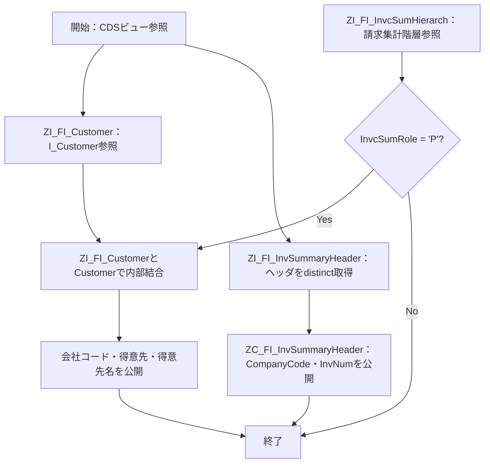

# README

# 要件書

## 業務要件

- [ ] 要確認

## 機能要件

入力：利用者がCDSビューを検索・参照する際の選択条件。各ビュー定義自体にパラメータは定義されていない。

出力：会社コード、得意先、得意先名、請求集計番号など、各CDSビューで定義された項目。

処理条件：ZI_FI_CustInvoiceSumでは請求集計ロールが 'P' のデータに限定し、階層データと得意先データを得意先コードで内部結合する。

機能上の制約：各ビューのキー項目と結合条件はCDS定義に従う。業務アプリケーション側の選択条件や表示動作は本ファイル群から確認できない。

## 業務フロー

- [ ] 要確認

# 概要書

## 処理概要

本プログラムパッケージは、請求集計に関するCDSビューを定義する。基本ビューで得意先、請求集計ヘッダ、請求集計階層を取得し、消費用ビューで請求集計ロールがPの得意先情報を会社コード単位に公開する。別の消費用ビューは会社コード・請求集計番号を値ヘルプ用に公開する。

### 1. 機能概要

- **機能名：** Customer Invoice Summary / Invoice Summary Header
- **処理方式：** ABAP CDS View Entity（基本ビューおよび消費用ビュー）
- **処理概要：** 標準CDSビューおよび請求集計関連データソースを参照し、得意先請求集計情報と請求集計ヘッダの参照用項目を提供する。

### 2. 処理詳細

1. **基本CDSビューで元データを定義する**
   - ZI_FI_CustomerでI_CustomerからCustomerとCustomerNameを取得する。
   - ZI_FI_InvSummaryHeaderでisjpinvsumhdからbukrsとinvsumnrを取得し、distinctで重複を除く。
   - ZI_FI_InvcSumHierarchでP_JP_invcsummaryhierarchから会社コード、得意先、請求集計ロールを取得する。
2. **得意先請求集計の消費用ビューを構成する**
   - ZI_FI_CustInvoiceSumでZI_FI_InvcSumHierarchとZI_FI_CustomerをCustomerで内部結合する。
   - InvcSumRoleが'P'のデータに限定し、会社コード・得意先・得意先名を公開する。
   - ZC_FI_CustInvoiceSumで会社コード・得意先・得意先名を消費用ビューとして公開する。
3. **請求集計ヘッダの値ヘルプ用ビューを構成する**
   - ZC_FI_InvSummaryHeaderでZI_FI_InvSummaryHeaderを参照する。
   - bukrsをCompanyCode、invsumnrをInvNumとして公開する。

### 3. 処理条件

| No. | 判定対象 | 判定条件 | 条件成立時の処理 | 条件不成立時の処理 |
|---|---|---|---|---|
| 1 | ZI_FI_CustInvoiceSumの請求集計ロール | InvcSumRole = 'P' | 会社コード・得意先・得意先名を結果に含める。 | 該当データを結果に含めない。 |
| 2 | ZI_FI_CustInvoiceSumの内部結合 | 請求集計階層のCustomerと得意先マスタのCustomerが一致する | 結合後の得意先情報を結果に含める。 | 一致する得意先マスタがない階層データは結果に含めない。 |
| 3 | ZI_FI_InvSummaryHeaderの重複排除 | 会社コード・請求集計番号の組合せが同一 | distinctにより重複行を1件にする。 | 異なる組合せをそれぞれ取得する。 |

### 4. 処理概要図

## 前提/制約条件

### **前提条件：**

- データソース：I_Customer、isjpinvsumhd、P_JP_invcsummaryhierarchが利用可能であること。
- CDS定義：参照する基本CDSビューが有効化されていること。

### **制約条件：**

- 対象条件：ZI_FI_CustInvoiceSumは請求集計ロールが'P'の階層データのみを対象とする。
- 結合条件：得意先情報はCustomerをキーに内部結合するため、対応する得意先データが存在しない階層データは結果に現れない。
- 出力項目：各ビューが明示的に選択した項目のみを公開する。
- 認可：ZI_FI_CustInvoiceSumはauthorizationCheck: #CHECK、その他のビューは定義上#NOT_REQUIRED。実際の権限制御はシステム設定に依存する。

## 依存関係

| **オブジェクト名** | **種類** | **用途** |
|---|---|---|
| ZI_FI_Customer | CDS View Entity（パッケージ内） | 得意先コードと得意先名を得意先請求集計ビューに提供する。 |
| ZI_FI_InvSummaryHeader | CDS View Entity（パッケージ内） | 請求集計ヘッダの会社コードと請求集計番号を消費用ビューに提供する。 |
| ZI_FI_InvcSumHierarch | CDS View Entity（パッケージ内） | 会社コード、得意先、請求集計ロールを得意先請求集計ビューに提供する。 |

### 使用公開API

| **API名** | **種類** | **用途** |
|---|---|---|
| I_Customer | 標準CDS View | 得意先コードと得意先名を取得する。 |
| isjpinvsumhd | データベーステーブル（ソースでの参照名） | 請求集計ヘッダの会社コードと請求集計番号を取得する。 |
| P_JP_invcsummaryhierarch | CDS View（標準／外部定義） | 請求集計階層の会社コード、得意先、請求集計ロールを取得する。 |

## 補足情報

### **メッセージ**

| **エラーケース** | **メッセージ** | **引数** | **補足** | **クラス** |
|---|---|---|---|---|
| - | - | - | - | - |

### データモデル・項目情報

| **オブジェクト名** | **項目名** | **用途** | **処理内容** |
|---|---|---|---|
| I_Customer | Customer, CustomerName | 得意先コードおよび得意先名 | 参照し、ZI_FI_Customerで公開する。 |
| isjpinvsumhd | bukrs, invsumnr | 会社コードおよび請求集計番号 | 参照し、distinctで重複を排除する。 |
| P_JP_invcsummaryhierarch | bukrs, kunnr, invsumrole | 会社コード、得意先、請求集計ロール | 参照し、CompanyCode・Customer・InvcSumRoleとして公開する。 |
| ZI_FI_CustInvoiceSum | CompanyCode, Customer, CustomerName | 得意先請求集計の参照項目 | 階層データと得意先データを結合し、ロールPに限定して公開する。 |
| ZC_FI_InvSummaryHeader | CompanyCode, InvNum | 請求集計ヘッダの値ヘルプ項目 | 会社コードと請求集計番号を別名で公開する。 |

### 例外処理

- **データ取得結果が0件の場合：** CDS定義内に0件時の個別処理は定義されていない。
- **設定情報が取得できない場合：** 設定情報の取得処理は定義されていない。
- **対象条件を満たさない場合：** InvcSumRoleが'P'でないデータはZI_FI_CustInvoiceSumの結果に含めない。
- **例外発生時：** CDS定義内に明示的な例外処理は定義されていない。
- **その他：** ZI_FI_InvSummaryHeaderではdistinctにより重複を排除する。

# テスト仕様書
## テスト仕様

| **大項目No.** | **小項目No.** | **テストケース（大項目）** | **テストケース（小項目）** | **確認内容・期待結果** |
|---|---|---|---|---|
| 1 | 1-1 | 得意先請求集計の取得 | 請求集計ロールがPで、得意先マスタに対応データが存在する | 会社コード・得意先・得意先名が結果に含まれること。 |
| 1 | 1-2 | 得意先請求集計の取得 | 請求集計ロールがP以外である | 対象データが結果に含まれないこと。 |
| 1 | 1-3 | 得意先請求集計の取得 | 階層データに対応する得意先マスタが存在しない | 内部結合のため該当する階層データが結果に含まれないこと。 |
| 2 | 2-1 | 請求集計ヘッダの取得 | 会社コードと請求集計番号の組合せが重複している | distinctにより重複行が排除されること。 |
| 2 | 2-2 | 請求集計ヘッダの取得 | 会社コードまたは請求集計番号が異なる | 異なるキーの組合せが別々の結果として取得されること。 |
| 3 | 3-1 | 消費用CDSビューの項目公開 | ZC_FI_CustInvoiceSumを参照する | CompanyCode、Customer、CustomerNameが公開されること。 |
| 3 | 3-2 | 消費用CDSビューの項目公開 | ZC_FI_InvSummaryHeaderを参照する | CompanyCodeとInvNumが公開されること。 |
| 4 | 4-1 | データなしの場合 | 参照元に該当するデータが存在しない | CDSビューの結果が0件となり、定義にない個別エラー処理は発生しないこと。 |
