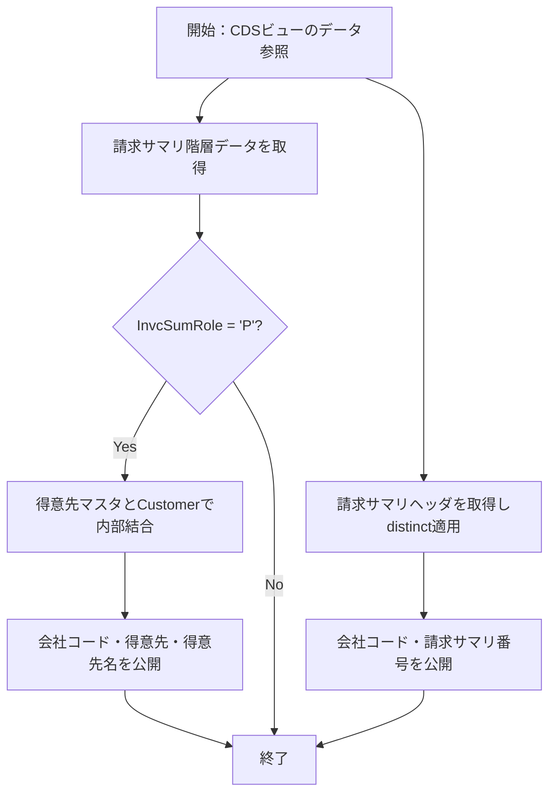

# README

# 要件書

## 業務要件

- [ ] 要確認

## 機能要件

入力：本プログラムパッケージ内のCDSビュー定義に基づき、下位CDSビューおよび参照先データソースを読み取る。外部入力パラメータは定義されていない。

出力：会社コード、得意先、得意先名を持つ得意先サマリ、および会社コードと請求サマリ番号を持つ請求サマリヘッダを公開する。

処理条件：得意先サマリでは請求サマリ階層の InvcSumRole が 'P' のデータを対象とし、得意先コードで得意先マスタと内部結合する。

機能上の制約：定義されている項目と結合・抽出条件に従う。更新処理や入力パラメータは定義されていない。

## 業務フロー

- [ ] 要確認

# 概要書

## 処理概要

本パッケージは、請求サマリ階層・請求サマリヘッダおよび得意先マスタを参照するCDSビュー群を定義する。

得意先サマリビューは役割が 'P' の階層データを得意先マスタと結合し、会社コード・得意先・得意先名を公開する。別の消費ビューがこの結果を公開する。

請求サマリヘッダビューはヘッダデータから会社コードと請求サマリ番号を取得し、消費ビューを通じて値ヘルプ用データとして公開する。

### 1. 機能概要

- **機能名：** 得意先請求サマリおよび請求サマリヘッダCDSビュー
- **処理方式：** CDS View Entity によるデータ参照・公開
- **処理概要：** 標準および独自の下位CDSビュー／データソースを参照し、得意先サマリと請求サマリヘッダの項目を公開する。

### 2. 処理詳細

1. **基礎データの取得**
   - ZI_FI_Customer は I_Customer から Customer と CustomerName を取得する。
   - ZI_FI_InvSummaryHeader は isjpinvsumhd から bukrs と invsumnr を取得し、distinct により重複を排除する。
   - ZI_FI_InvcSumHierarch は P_JP_invcsummaryhierarch から会社コード・得意先・請求サマリ役割を取得する。
2. **得意先サマリの生成**
   - ZI_FI_CustInvoiceSum は ZI_FI_InvcSumHierarch と ZI_FI_Customer を Customer で内部結合する。
   - InvcSumRole = 'P' のデータに絞り、会社コード・得意先・得意先名を出力する。
3. **消費用ビューによる公開**
   - ZC_FI_CustInvoiceSum は ZI_FI_CustInvoiceSum から会社コード・得意先・得意先名を公開する。
   - ZC_FI_InvSummaryHeader は ZI_FI_InvSummaryHeader から会社コードと請求サマリ番号を公開し、値ヘルプ用途として定義される。

### 3. 処理条件

| No. | 判定対象 | 判定条件 | 条件成立時の処理 | 条件不成立時の処理 |
|---|---|---|---|---|
| 1 | ZI_FI_CustInvoiceSum の階層データ | InvcSumRole = 'P' | 対象データを得意先マスタとの内部結合処理に進める。 | 抽出対象から除外する。 |
| 2 | 得意先マスタとの結合 | 階層データの Customer と得意先マスタの Customer が一致する。 | 結合された得意先コードと得意先名を出力する。 | 内部結合のため、対応する得意先マスタがない階層データは出力されない。 |
| 3 | ZI_FI_InvSummaryHeader の取得結果 | 同一の bukrs と invsumnr の行が複数存在する。 | distinct により重複行を排除する。 | 取得行をそのまま出力する。 |

### 4. 処理概要図

## 前提/制約条件

### **前提条件：**

- 設定情報：参照先の I_Customer、P_JP_invcsummaryhierarch および isjpinvsumhd が利用可能であること。
- データ情報：参照対象となる得意先、請求サマリ階層および請求サマリヘッダのデータが存在すること。

### **制約条件：**

- 処理対象：得意先サマリは InvcSumRole が 'P' の階層データに限定される。
- 結合条件：得意先マスタとの内部結合に一致しない階層データは得意先サマリに出力されない。
- 出力範囲：各ビューで明示された項目のみを公開し、更新処理は定義されていない。
- 請求サマリヘッダ：ZI_FI_InvSummaryHeader では会社コードと請求サマリ番号の組合せに対して distinct を適用する。

## 依存関係

| **オブジェクト名** | **種類** | **用途** |
|---|---|---|
| | | |

### 使用公開API

| **API名** | **種類** | **用途** |
|---|---|---|
| I_Customer | 標準CDS View | 得意先コードと得意先名の参照元。 |
| P_JP_invcsummaryhierarch | 標準CDS View | 請求サマリ階層の会社コード・得意先・役割の参照元。 |
| isjpinvsumhd | データベーステーブル（CDS参照元） | 請求サマリヘッダの会社コードと請求サマリ番号の参照元。 |
| ZI_FI_CustInvoiceSum | 独自CDS View Entity | 得意先サマリを生成し、消費ビューに公開する。 |
| ZI_FI_Customer | 独自CDS View Entity | 得意先コードと得意先名を提供する。 |
| ZI_FI_InvSummaryHeader | 独自CDS View Entity | 請求サマリヘッダ項目を消費ビューに提供する。 |
| ZI_FI_InvcSumHierarch | 独自CDS View Entity | 請求サマリ階層データを提供する。 |

## 補足情報

### **メッセージ**

| **エラーケース** | **メッセージ** | **引数** | **補足** | **クラス** |
|---|---|---|---|---|
| | | | | |

### データモデル・項目情報

| **オブジェクト名** | **項目名** | **用途** | **処理内容** |
|---|---|---|---|
| I_Customer | Customer、CustomerName | 得意先コードおよび得意先名を提供する。 | ZI_FI_Customer で参照する。 |
| P_JP_invcsummaryhierarch | bukrs、kunnr、invsumrole | 請求サマリ階層の会社コード、得意先、役割。 | ZI_FI_InvcSumHierarch で参照し、会社コード・得意先・役割を公開する。 |
| isjpinvsumhd | bukrs、invsumnr | 請求サマリヘッダの会社コードと請求サマリ番号。 | ZI_FI_InvSummaryHeader で参照し、distinct を適用する。 |
| ZI_FI_CustInvoiceSum | CompanyCode、Customer、CustomerName | 得意先請求サマリの公開項目。 | 階層データと得意先マスタを内部結合し、役割Pのデータを出力する。 |
| ZI_FI_InvSummaryHeader | bukrs、invsumnr | 請求サマリヘッダの識別項目。 | 消費ビュー ZC_FI_InvSummaryHeader に公開する。 |

### 例外処理

- **データ取得結果が0件の場合：** 明示的な例外処理は定義されていない。CDSビューの検索結果として該当データが返らない。
- **設定情報が取得できない場合：** 設定情報取得処理や専用の代替処理は定義されていない。
- **対象条件を満たさない場合：** InvcSumRole が 'P' でないデータは抽出対象外となる。内部結合に一致しないデータも出力されない。
- **例外発生時：** ソース内に明示的な例外処理は定義されていない。
- **その他：** ZI_FI_InvSummaryHeader は distinct により重複行を排除する。

# テスト仕様書
## テスト仕様

| **大項目No.** | **小項目No.** | **テストケース（大項目）** | **テストケース（小項目）** | **確認内容・期待結果** |
|---|---|---|---|---|
| 1 | 1-1 | 得意先サマリ取得 | 役割Pかつ得意先マスタに一致するデータ | 会社コード、得意先、得意先名が出力される。 |
| 1 | 1-2 | 得意先サマリ取得 | 役割がP以外のデータ | 該当データは出力されない。 |
| 1 | 1-3 | 得意先サマリ取得 | 得意先マスタに一致するCustomerがないデータ | 内部結合のため該当データは出力されない。 |
| 2 | 2-1 | 請求サマリヘッダ取得 | ヘッダデータが存在する | 会社コードと請求サマリ番号が出力される。 |
| 2 | 2-2 | 請求サマリヘッダ取得 | 同一の会社コード・請求サマリ番号が重複する | distinct により重複行が排除される。 |
| 2 | 2-3 | 請求サマリヘッダ取得 | 該当ヘッダデータが存在しない | 該当する結果行は返されない。 |
| 3 | 3-1 | 消費ビューの項目公開 | 得意先サマリ消費ビューを参照する | 会社コード、得意先、得意先名が公開される。 |
| 3 | 3-2 | 消費ビューの項目公開 | 請求サマリヘッダ消費ビューを参照する | 会社コードと請求サマリ番号が値ヘルプ用ビューとして公開される。 |
