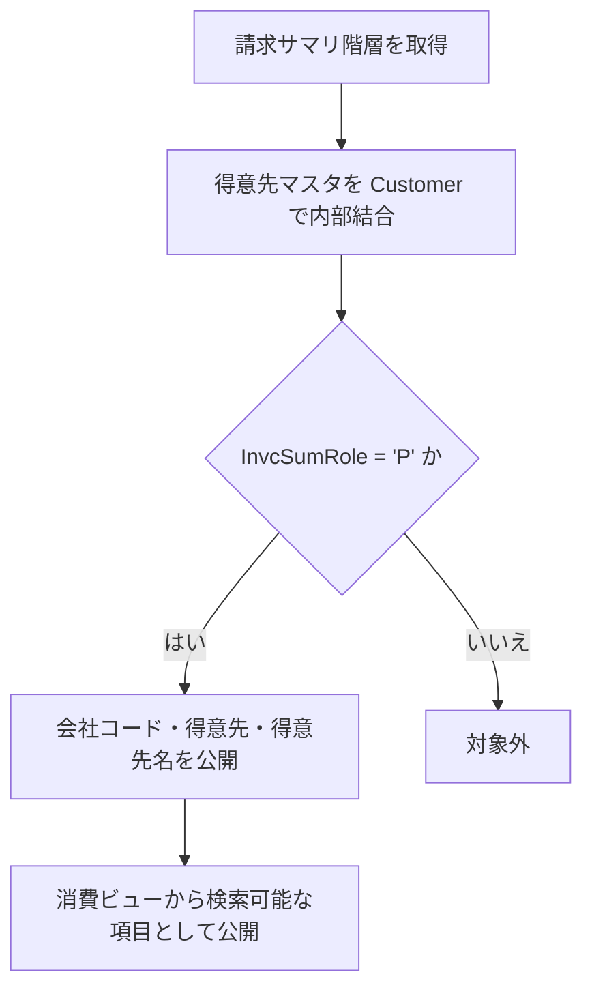

# README

# 要件書

## 業務要件

- [ ] 要確認

## 機能要件

入力：本パッケージのCDS Viewを通じて会社コード、得意先、得意先名、請求サマリ番号を参照する。

出力：顧客請求書サマリおよび請求サマリヘッダの項目を公開する。

処理条件：顧客請求書サマリでは請求サマリ階層のロールが 'P' のデータを対象とする。

機能上の制約：データ取得・更新処理は定義されておらず、CDS Viewによる参照機能である。

## 業務フロー

- [ ] 要確認

# 概要書

## 処理概要

CDS View群により請求サマリ階層と得意先マスタを関連付け、顧客請求書サマリおよび請求サマリヘッダの参照項目を提供する。

### 1. 機能概要

- **機能名：** 顧客請求書サマリ／請求サマリヘッダ参照
- **処理方式：** CDS View Entity
- **処理概要：** 基本ビューで標準得意先・請求サマリデータを公開し、消費ビューで結合、ロール絞り込み、検索用アノテーションおよび値ヘルプ項目を定義する。

### 2. 処理詳細

1. **基本ビューによるデータ公開**
   - ZI_FI_Customer は I_Customer から Customer と CustomerName を公開する。
   - ZI_FI_InvSummaryHeader は ISJPINVSUMHD から会社コードと請求サマリ番号を取得する。
   - ZI_FI_InvcSumHierarch は P_JP_invcsummaryhierarch から CompanyCode、Customer、InvcSumRole を公開する。
2. **顧客請求書サマリの構成**
   - ZI_FI_CustInvoiceSum は ZI_FI_InvcSumHierarch と ZI_FI_Customer を Customer で内部結合する。
   - InvcSumRole = 'P' のデータに絞り込み、CompanyCode、Customer、CustomerName を公開する。
   - ZC_FI_CustInvoiceSum はこの結果を消費ビューとして公開し、Customer をデフォルト検索要素に指定する。
3. **請求サマリヘッダの値ヘルプ構成**
   - ZC_FI_InvSummaryHeader は ZI_FI_InvSummaryHeader を参照し、CompanyCode と InvNum をキーとして公開する。
   - InvNum をデフォルト検索要素に指定し、値ヘルプ用データカテゴリを設定する。

### 3. 処理条件

| No. | 判定対象 | 判定条件 | 条件成立時の処理 | 条件不成立時の処理 |
|---|---|---|---|---|
| 1 | 請求サマリロール | ZI_FI_CustInvoiceSum の InvcSumRole が 'P' | 顧客請求書サマリの対象として出力する。 | WHERE 条件により出力対象外となる。 |

### 4. 処理概要図

### **前提条件：**

- データソース設定：I_CUSTOMER、P_JP_INVCSUMMARYHIERARCH、ISJPINVSUMHD が利用可能であること。

### **制約条件：**

- 対象データ：顧客請求書サマリは InvcSumRole = 'P' のデータに限定される。
- 処理範囲：CDS Viewによる参照定義であり、データ更新処理は含まれない。
- アクセス制御：各ビューの authorizationCheck アノテーション設定に従う。

## 依存関係

| **オブジェクト名** | **種類** | **用途** |
|---|---|---|
| - | - | - |

### 使用公開API

| **API名** | **種類** | **用途** |
|---|---|---|
| I_CUSTOMER | CDS View | 得意先コードと得意先名を取得する。 |
| P_JP_INVCSUMMARYHIERARCH | CDS View | 請求サマリ階層の会社コード、得意先、ロールを取得する。 |
| ISJPINVSUMHD | Database Table/View | 請求サマリヘッダの会社コードと請求サマリ番号を取得する。 |
| ZI_FI_Customer | CDS View | 得意先情報を基本ビューとして公開する。 |
| ZI_FI_InvcSumHierarch | CDS View | 請求サマリ階層情報を基本ビューとして公開する。 |
| ZI_FI_InvSummaryHeader | CDS View | 請求サマリヘッダ情報を基本ビューとして公開する。 |
| ZI_FI_CustInvoiceSum | CDS View | 顧客請求書サマリを消費ビューへ提供する。 |

## 補足情報

### **メッセージ**

| **エラーケース** | **メッセージ** | **引数** | **補足** | **クラス** |
|---|---|---|---|---|
| - | - | - | - | - |

### データモデル・項目情報

| **オブジェクト名** | **項目名** | **用途** | **処理内容** |
|---|---|---|---|
| ZI_FI_InvcSumHierarch | CompanyCode、Customer、InvcSumRole | 請求サマリ階層と親ロールの識別 | 参照し、InvcSumRole = 'P' を判定する。 |
| ZI_FI_Customer / I_CUSTOMER | Customer、CustomerName | 得意先と名称 | Customer で内部結合し、CustomerName を出力する（参照）。 |
| ISJPINVSUMHD / ZI_FI_InvSummaryHeader | BUKRS、INVSUMNR | 請求サマリヘッダの識別 | 重複排除して参照し、CompanyCode と InvNum として公開する。 |

### 例外処理

- **データ取得結果が0件の場合：** CDS View の検索結果は0件となる。
- **設定情報が取得できない場合：** 該当する設定情報取得処理はない。
- **対象条件を満たさない場合：** InvcSumRole が 'P' 以外のデータは顧客請求書サマリから除外される。
- **例外発生時：** ソースコード上に独自例外処理は定義されていない。
- **その他：** CDS View のアクセス制御は各ビューのアノテーションに従う。

# テスト仕様書

## テスト仕様

| **大項目No.** | **小項目No.** | **テストケース（大項目）** | **テストケース（小項目）** | **確認内容・期待結果** |
|---|---|---|---|---|
| 1 | 1-1 | 顧客請求書サマリの正常系 | 親ロールのデータが存在する | 会社コード、得意先、得意先名が取得される。 |
| 1 | 1-2 | 顧客請求書サマリの正常系 | 得意先マスタに対応するデータが存在する | Customer キーで内部結合され、得意先名が表示される。 |
| 2 | 2-1 | 顧客請求書サマリの条件分岐 | InvcSumRole が 'P' 以外 | 対象データとして出力されない。 |
| 3 | 3-1 | 請求サマリヘッダの正常系 | ヘッダデータが存在する | CompanyCode と InvNum がキー項目として取得される。 |
| 3 | 3-2 | 請求サマリヘッダの境界系 | 重複データが存在する | DISTINCT により重複行が排除される。 |
